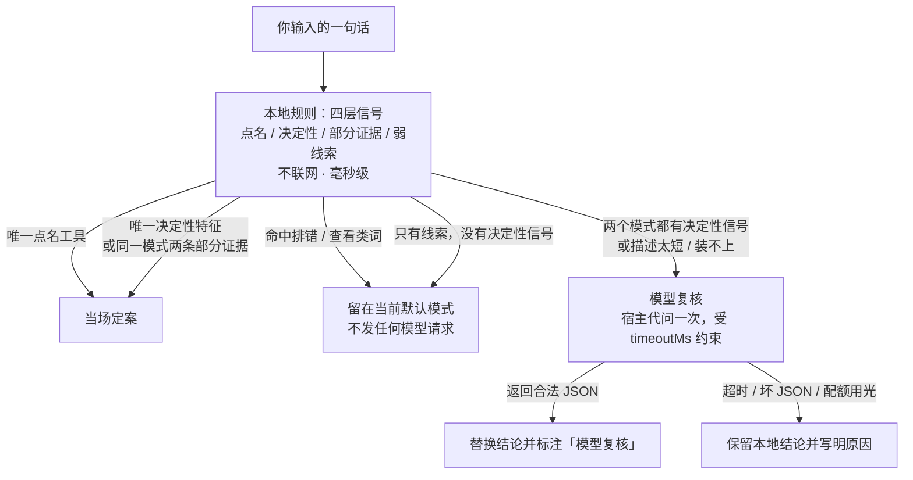

# dsh-npie-modeguide

[](https://github.com/BannyLon/dsh-npie-modeguide/actions/workflows/check.yml)
[](LICENSE)
[](https://www.npmjs.com/package/@deepseek-ai/dsh)

[English](README.en.md) | 中文

不知道 DeepSeek Harness 的四个 Agent 预设（标准 / PTC / 极简 / 创造）该用哪个？
把任务写成一句话，这个插件帮你判断，并给出**两句可复核的理由**说明为什么。

## 安装

web 等**非 desktop** profile 一条命令：

```sh
dsh plugin --profile web add github:BannyLon/dsh-npie-modeguide
```

这条命令做两件事，第二件 dsh 不会打印出来：pnpm 把包装进 profile 的 `dependencies`，
然后 CLI 读这个包的 `dsh.bundle.patch`，**自动把包名追加进 `dsh.profile.bundles`**。
所以老经验里那句「装了却没加载、还不报错」在这条路径上**不成立** —— 0.3.0 在一个干净
profile 里实测过：装完 `package.json` 的 `bundles` 已经有它
（dsh 的实现就是「新装依赖里带 `dsh.bundle` 的自动进 bundles」）。

反过来说：**包没声明 `dsh.bundle` 时**，CLI 会明说
`declares no dsh.bundle — installed as a plain dependency, not a profile layer` ——
那才是「装了等于没装」，而且它是**有警告**的。本插件声明了，所以你不用手改。

**桌面端是例外。** `desktop` profile 归 Electron 应用独占管理，CLI 直接拒绝：

```
$ dsh plugin --profile desktop why dsh-npie-modeguide
error: profile "desktop" is managed exclusively by the Electron application
```

所以桌面端必须手改三处，见下面「安装（桌面端）」一节。装完**退出重开**（`Cmd+Q`，
客户端半区没有热更新），输入框左侧出现模式图标，写完任务它会直接显示「建议：X」，
点它才展开理由。

本地开发时用 `link:` 更省事：`"dsh-npie-modeguide": "link:/绝对路径"`，改完
`npm run build` 再重开即可（`client.js` 是构建产物，不构建就不会生效）。

## 它解决的问题

四个预设的描述都写得很抽象，用户常常搞不清自己该选哪个。常见的误解有三个：

- 以为「任务简单」就该用极简模式。**不对** —— 极简模式的用途是做纯净基线对照，
  不是省事。
- 以为「批量处理数据」一定要换模式。**看你的默认** —— 内置默认 PTC 本来就带
  execute 代码执行器，默认是 PTC 就压根不用动；只在你把默认改成标准模式之后，
  「批量处理一批文件」才会被判成要换 PTC（插件跟着你的默认走，见「新任务默认
  模式」一节）。
- 以为「创造模式功能最多所以最好用」。**不准确** —— 它没有 Office 工具。

## 判断原则

插件不判断「任务是什么类型」，而是判断**「任务需要哪个模式独有的工具」**。
因为四个预设只在少数工具上有差异，而这些差异才是换模式唯一正当的理由。

实测出的差异（按当前版本预设解析；能力表共有 13 行差异，下表是影响选择的 8 行节选）：

| 能力 | 极简 | 标准 | PTC | 创造 |
|---|---|---|---|---|
| 文件读写 | ✗ | ✓ | ✓ | ✓ |
| 联网检索 | ✗ | ✓ | ✓ | ✓ |
| 子代理 | ✗ | ✓ | ✓ | ✓ |
| 工作流编排 | ✗ | ✓ | **✗** | ✓ |
| execute 代码执行 | ✗ | ✗ | **✓** | ✗ |
| Office 文档 | ✗ | ✓ | ✓ | **✗** |
| 改 DSH 本体 | ✗ | ✗ | ✗ | **✓** |
| 插件管理 | ✗ | ? | ✗ | ? |

`?` = 预设里这一项带 `!!js` 平台条件，静态解析求不出值，实际取决于运行环境；
界面能力表也标 `?`。早期表格把这两格写成 ✓，等于把「视环境而定」当成了「确定有」。

由此**只有四种**情形需要换模式，其余全部留在**你设的新任务默认模式**
（下表第 5 行是「不换」；默认由宿主实时下发，不是写死的 PTC）：

| 你要做的事 | 选 | 为什么 |
|---|---|---|
| 写插件、改预设、加界面 | 创造 | 只有它有改 DSH 本体的工具 |
| workflow 大扇出编排 | 标准 | PTC 关掉了工作流工具 |
| 纯净基线 / 对照实验 | 极简 | 只有它刻意砍掉能力 |
| 批量处理一批文件（批量重命名、去重汇总、遍历目录） | PTC | 只有它有 execute 代码执行器，一次调完所有工具、只回结果 |
| 其它一切 | 当前新任务默认 | 不换 |

注意第 4 行的口径：标准模式的 bash 也能循环，所以这条**不是**「缺了它做不了」，
而是「一次调完、不用把几百个文件的内容塞进上下文」。它排在最后，且必须凑够两条
部分证据（或一个决定性说法）才成立 —— 这就是「统计一下这张表有多少行」不会被判成
PTC 的原因。

## 判断链路

两套判据，先用便宜的那套；只有它拿不准才动贵的。`本地` 指插件里的一段纯函数，
不联网、不碰模型；`模型复核` 指宿主代你发的一次模型请求。



本地这一层不是「猜任务类型」，只回答一个问题：**这个任务需要某个模式独有的工具吗**。
判据按「缺了它还能不能用别的模式做完」分四层，权重不同：

| 信号层 | 定案条件 | 例子 | 语义 |
|---|---|---|---|
| `pinned` 点名工具 | 单条即可 | 「写个插件」「用工作流」「跑基线」 | 你明确要它，是指令，压过其它一切信号 |
| `strong` 决定性特征 | 单条即可 | 「批处理」「批量重命名」「一次性跑完」 | 这个词本身就意味着缺了它做不了 |
| `support` 部分证据 | 同一模式 **凑够 2 条**（弱线索算半条，向下取整） | 「统计」「重命名」「去重」「工作流」 | 是能力的一部分，不是全部 |
| `weak` 方向暗示 | 永不定案 | 「整理」「表格」「面板」 | 只作旁证 |

再加一条**组合判据**：动作词（加 / 改 / 做 / add / edit）与 DSH 内部对象（面板 /
预设 / 快捷键 / 主题 / panel / preset）出现在同一小段里，才算「要改 DSH 本身」。
单看任一边都没有意义 —— 「加一点盐」里的加、「这个面板太大」里的面板，都不该换模式。

同一个判据还管住了 PTC 的「遍历」：它不是决定性特征。遍历一个 JSON、遍历一个数组
都是普通编程，标准模式的 bash 照样能做；只有「遍历 + 目录 / 所有文件 / 这批文件」
才构成 execute 的场景。盲测里「遍历一下这个 JSON 看看结构」原本被判成 PTC，
就是靠这条降级修正的。

**为什么 `support` 要凑两条**：0.1.x 一个词就定案，于是「帮我统计一下这份表格有多少行」
被判成 PTC —— 「统计」确实是能力的一部分，但标准模式的 bash 就够，压根不需要
execute。结论错了，理由却因为引用了真实能力分布而读起来像事实，这是最有欺骗性的
失败模式。现在单条线索只给方向、不定案；而「批量 + csv + 表格」这种一条部分证据加
两条弱线索的组合才算够（弱线索每条算半条：一条部分证据加一条弱线索仍然不够）。

还有一张**反向词表**：排错 / 查看 / 解释现状的说法（报错、没生效、为什么、修一下、
怎么回事 / why、not working、debug）命中即压回默认模式，而且**不再问模型**。
「我装了个插件，为什么没生效」里的「插件」是强信号，但这句话要的是排错，不是写插件。

比它更靠前还有一道闸：**「在问模式本身」**（区别 / 哪个好 / 该用哪个 / 怎么选）。
这类句子里几乎必然出现「PTC 模式」这样的字面，而点名判据是**字面命中即定案**的 ——
不先拦下来，「对比一下标准模式和 PTC 模式的区别」就会被读成「你要用 PTC」。

同层还有两类别扭进来的：**讲解**（讲讲 / 是怎么 / 解释下）与**卸载**。前者要的是
知识不是产能，后者是宿主设置页里的操作 —— 都不是「某个模式独有的任务」。

否定词同样会作用到英文（`don't use workflow`、`don’t` 这种弯引号也算），窗口内命中
即作废。短于 4 个字的描述直接判「信息不足」。

判完只有三种去向：

1. **当场定案** —— 唯一点名、唯一 `strong`、或同一模式两条 `support`。
2. **留在当前默认模式** —— 没有决定性信号，或命中反向词。这是「已确认不用换」，
   不是拿不准，所以不会去问模型。
3. **交模型复核** —— 两个模式都有决定性信号（「这个插件要批量处理这批文件」）、
   描述太短、或该模式不在清单里。

模型复核不是让它自由发挥：宿主把当前默认模式、13 行能力差异表、五条纪律（能不换
就不换 / 别为显得聪明而建议换 / **排错类描述一律不换** / 只输出一行 JSON）一起发
过去，`maxTokens` 200、`temperature: 0`；回来严格校验 `mode` 必须在预设 id 内、
`confidence` 夹到 0.5–0.85，坏 JSON、超时、配额用光一律当「没有结论」。
示例值写成 `<one of: …>` 而不是某个具体模式，否则模型会倾向原样回抄（锚定偏置），
于是「该换也不换」而界面上看不出来。

**先后顺序**（点「给建议」那一刻）：

1. 本地规则**同步**跑完，结论、两句理由和能力表**当刻**画出来，不等任何远程调用；
2. 同一时刻后台并行做两件与判断无关的事：能力表实时校正、默认模式复查；
3. 只有第 3 类才在后台发一次模型请求，等待上限由 `timeoutMs` 派生（默认 20000 +
   2s 余量，下限 6s）；
4. 模型回来替换结论并标注「模型复核」，失败则保留本地结论并写明原因。

合并优先级是写死的：**规则已定案 > 模型结论 > 默认模式**。模型不能推翻本地已经
定案的结论 —— 「写个插件」这种你明说的事，不该被一次模型调用改错。只有单条线索时
结论同样是默认模式，但那不是「模型说的」也不是「规则说的」，理由会明说「只有线索，
不足以要求换模式」。代价是本地判错时模型也救不回来，见「已知的边界」。

## 输入即显示：把「四步」压成「一步」

0.2.2 及以前，用户要按「输入 → 点按钮 → 等 → 读理由 → 再点」才拿到一个建议。四步里
只有最后一步是真正需要的，前三步都是这个插件的成本 —— **成本高于收益时，判得再对也没人用**。

现在的行为：你在输入框里写完停手 **500ms**，工具栏那个模式图标上直接出现「建议：X」，
不弹面板、不动布局。点它才展开完整结论与理由（此时结论已经画在那里，不再等一次判定）。

四个边界是刻意收窄的，每条都有断言：

| 边界 | 行为 | 为什么 |
|---|---|---|
| 本地规则**定案**（`kind === 'decided'`） | 出徽标 | 只有定案才值得说；`suggest` / 拿不准时闭嘴 |
| 结论**与当前默认不同** | 出徽标 | 相同的话「建议：X」是错的，X 本来就是当前模式 |
| 面板**没开着** | 出徽标 | 面板开着时完整结论已经在眼前，徽标是重复 |
| 草稿 **≥ 8 字** | 出徽标 | 「帮我」「改一下」这类半句在哪个模式下都成立，挂个「建议：创造」只会训练用户无视徽标 |

**这条路径上一次 `fetch` 都没有。** 徽标只跑本地规则（毫秒级、不联网、不碰模型），
所以它不花配额、不产生「问得太频繁」、断网也照常出现 —— 有判据盯着「出徽标的那条
路径里不许出现任何网络调用」，改坏了就红。

代价也写清楚：徽标只覆盖本地规则**能定案**的那部分输入。遇到信号冲突（「这个插件要
批量处理这批文件」）它不会显示任何东西 —— 那种情况仍然要你点一下才走第 3 层模型复核。
这是有意的：一个「可能对」的常驻徽标，比没有徽标更容易让人做错决定。

## 准确率：判得对是唯一的验收线

这个插件只有一个目的：**判断必须对**。所以准确率不是一个形容词，而是一条能跑的命令：

```bash
npm run eval
# [eval]           133/133 通过（100%）· 卡线 · main 108/108 · heldout 25/25
# [eval:external]   54/55  通过（98.2%）· 不卡线
# [eval:external2]  40/40  通过（100%） · 不卡线
# [eval:external3]  36/40  通过（90%）  · 不卡线
```

**集合分两层，口径不同 —— 这是本节最重要的一句话。**

| 集合 | 文件 | 来源 | CI 卡线 |
|---|---|---|---|
| main 调参集 | `test/eval/cases.json` | 我写的，调规则时改的就是它 | ✅ 卡 100% |
| heldout 留出集 | `test/eval/cases-heldout.json` | 我写的，但**不参与调规则**，只验泛化 | ✅ 卡 100% |
| external ×3 | `external.json` / `-2` / `-3` | **真实会话日志里的用户原话**（脱敏） | ❌ 只公布 |

为什么不卡外部集：拿它卡线等于把体温计拿去加热 —— 它红了我就改规则，改完它绿了，
而世界没变好一点。它**红着**才说明「今天仍然会在这种说法上判错」，这个信息比一个绿色的
100% 有用得多。想把它冻结成回归集，先用 `--gate-external` 自己确认它确实是「我之外的说法」。

**首轮数字才算泛化能力。** 三批外部集是分三次从会话日志里捞出来、脱敏、标注、跑一遍，
跑完才回头改规则。下表左边是**改规则之前**那一遍，右边是改完之后（后者只证明「那些错法
被修掉了」，不证明别的）：

| 批次 | 条数 | 首轮 | 修完 | 修完那一版动了哪些规则 |
|---|---:|---:|---:|---|
| external-1 | 55 | 63.6%（35/55） | 98.2%（54/55） | 主要一项：「插件」从 strong 降成对象名（单这一项就把 63.6% 推到 87.3%），其余由后几类规则补齐 |
| external-2 | 40 | 72.5%（29/40） | 100%（40/40） | 其余五类：功能/交互配通用动词、问可能性、组合窗口、否定、复合词 |
| external-3 | 40 | **85%（34/40，先冻结再跑）** | 90%（36/40） | 只补了两类覆盖面，其余 4 条留作已知缺陷 |

第三批是**先冻结再跑**：标注完成后我没再看它，直接跑一遍出 85%，之后只补了两类覆盖面，
剩下 4 条（「那就添加这两项：…」「toggle 的 title 和 aria-label，由「停用 / 启用」改为
明确语义」这类**没有动作词、只有指令语气**的说法）**明确留作已知缺陷**，没有为它开洞 ——
它们的共同形状与为什么不修，写在 `docs/benchmark-2026-11-16.md` §7。

有两条必须说清，否则上面的数字就是在骗人：

- **说法是真的，标注是我补的。** 输入逐字来自 `~/.workbuddy/projects/*/*.jsonl` 的
  `<user_query>`，脱敏（无路径 / 链接 / token）；但「这句该判哪个模式」是我标的。
  它证明「没见过的说法现在判得怎么样」，**不能当成第三方盲测**。
- **自建集 100% 与外部集首轮 63.6% 之间那道落差，就是 0.2.2 之前那个「100%」的真实含量。**

用例本身的写法有三条规矩：

- 每条都写清 `why`：判错时要能立刻分清是实现错还是用例本身错。
- 一半以上是「不该换」类，而且这类要在**两种默认**（standard / ptc）下都成立 ——
  宁可不动，不可乱动。
- `npm run check` 跑同一份评测并卡前两层 100%，任何一条不过就退出 1。

历史对照：0.1.11 在 14 例人工样本上是 9 对、2 例侥幸、3 例明确判错，其中
「帮我统计一下这份表格有多少行」被判成 PTC、「我装了个插件，为什么没生效」被判成
创造、「write a plugin that adds a sidebar panel」被留在默认（英文规则近乎为零）。
三条现在都是回归用例。

边界也要写清：外部集证明的是「这 135 种说法里判对了 130 种」，不是「所有说法都判对」。
真正的兜底是界面上那两句可展开核对的理由 —— 判错时你能看见它错在哪一行。

## 模型兜底的配额

连点「给建议」不再等于连打模型。下面几条都在宿主半区执行（客户端只负责把结论
说给用户听）：

| 限制 | 值 | 行为 |
|---|---|---|
| 突发容量 | 5 次 | 前 5 次不同输入的模型复核直接放行 |
| 补充速度 | 每 20 秒 1 次 | 用光后按此速率恢复（约 3 次/分钟持续） |
| 同句复用 | 5 分钟 | 输入与能力表都没变时直接返回上次结论（`cached: true`），**不扣配额** |
| 空输入 | — | 回 400 `invalid-input`，不扣配额：客户端的 bug 不该花你的额度 |
| 模型不可用 | — | 一次请求都没发出去（未配模型 / llm 服务缺席）时退回配额，不误报「问得太频繁」 |

配额用光时 `/judge` 回 `429` + `retryAfterMs`（响应头另带 `retry-after`），界面
据此说「约 12 秒后可再问，这次先按本地规则给建议」，而不是笼统说「模型没回应」。
秒数只从宿主下发值来 —— 客户端不存第二份配额数字，免得改了常量界面还报旧数。

配额是宿主常量 `JUDGE_LIMITS`，不在 `cordis.patch.yml` 里，改不了。要做成可配置
得先加配置 schema，属于另一件事。

## 结论里的两句理由

每次出结论都会有**两句**说明，中文界面实例如「给我写个插件」：

> 命中「写个插件、插件」，是你点名要用的工具，属于明确指令，说明这个任务取决于
> 模式之间的能力差异。依据当前版本内核预设解析出的 13 项差异，「改 DSH 本体」在
> 各模式里的分布是：只有「创造模式」具备；这就是选「创造模式」的事实依据，可展开
> 下面的差异表逐项核对。

第一句说**任务侧**：命中了什么词、是「点名指令」还是「任务特征」；只有线索时会明说
「不足以要求换模式」，一个信号都没有时明说「没有任何独有工具需求」，命中排错词时
明说「这是在排查或询问现状」。
第二句说**事实侧**：关键能力在各模式里的真实分布、差异项数、依据来源，并指向
可展开的差异表。连「该模式独占还是与别的模式共有」都是逐项读能力表算出来的，
不是写死的中文句子 —— 内核升级后写死的句子会继续用旧口径骗人。

四种结论来源口径不同：规则判断讲命中信号；模型复核会**明说来自模型、不是本地
规则**；排错类会明说「不涉及换模式」；默认结论会明说「没有任何一项差异是这个任务
必需的」，并指出留在当前默认、其它模式多出来的能力这个任务也用不上。
任何一条都不会把单条线索包装成「必须用」。实时能力表校正成功后，理由
也会按新表重算，不会出现「表里是 ✓、理由还说着关掉了」。

「绝对准确」不能承诺，边界写在这里：准确率有一条可跑的验收线（见上节），但用例集
是自建的；能力表是构建期基线（后台实时校正成功才换），内核升级后没刷新基线时事实
依据可能落后一个版本；规则识别的是明确说法，反讽、双重否定这类语义仍要靠第 3 层
或直接看官方模式下拉。

**能力表不依赖 Remote。** `ctx.remote.agentPresets` 是一个**独立的 cordis service**，
不是 `remote` 的附属属性：fiber 的 `inject` 必须单独列 `'remote.agentPresets'`
（官方 `dsh-client-ui-agent-preset` 就是这么写的）。少这一项时属性代理直接抛
`cannot get property "remote.agentPresets" without inject`，`?.` 拦不住抛 ——
0.1.3 的「预设暂时读不到」与 0.1.5 的「切换失败」其实是同一个根因。
注意 `module.exports.inject`（service 名）与 `dsh.client.inject`（预加载包名）是两层，
改错层毫无效果。即便声明齐了，unary 调用还要过 gateway carrier；离线时折进
`RemoteResult` 的 error 分支（宿主规范明写「不抛异常」），四次 `read()` 仍可能全
拿不到内容。所以能力表用构建期基线当场画，后台实时校正四个都读到才替换，
失败完全静默。

**能力表与判断主路径都不调 `agentPresets.list()`**：它会走 `diagnostic()` →
`await loader.await()` 死等，只要有一个插件行在等不来的服务就永不返回。唯一的例外是
「`/config` 没读到新任务默认」时的兜底（见下节），那一次带 1.2s 独立硬超时、纯后台，
失败就当作读不到。

客户端打开浮层时读一次宿主配置，**每次判断与需要模型兜底前再现读一次**（避免用到
打开浮层时 fire-and-forget 的旧值）：把 `llmFallback` 设成 `false` 后连模型请求都不发，
`timeoutMs` 同时决定客户端愿意等多久。

## 判错了就按 👎：反馈只写本机

结论区下面有一行「这个判断对吗？」，两个按钮 👍 / 👎。它解决的问题很具体：
**自建用例集证明不了没见过的那句话**（见上节边界），而判错的成本只有用户自己知道。
点一下就把「原文 + 结论 + 理由 + 版本」记在本机，攒起来就是下一版规则要补的用例。

写到哪里：`$DSH_PROFILE_DIR/npie-modeguide/feedback.jsonl`，一行一条。只收白名单
**十个**字段 —— `at / thumb / mode / source / signal / defaultMode / hits / lang /
ruleVersion / input`，你输入里夹带的任何额外内容都不会被写进去，`at` 由宿主盖戳，
伪造无效。输入超过 500 字截到 500（留着判断依据，不留全文）。文件到 5 MB 滚动一份
`feedback.1.jsonl`，只保留上一份。

`hits`（0.3.0 新增）是**这句判断命中了哪几个词**，最多 6 个、每个截到 24 字。
加它只为一件事：没有命中词，`--cluster` 只能说「这类又错了 3 次」，说不出
**「这 3 次都是被同一个词带跑的」** —— 后者才是能直接改成规则动作的那句话。
`signal` 与 `defaultMode` 同理，只服务归因，不参与任何界面显示。

三条刻意的边界：

- **不联网、不遥测。** 没有上报端点，没有任何自动发送，删掉这个文件就什么都不剩。
- **按了之后锁定**，两个按钮都 `disabled`，`aria-pressed` 标出选中的那个，避免
  反复点把同一条记成几十行。想改主意就再判一次。
- **写不进去就说实话。** 没有 profile 目录（未登录 / 只读环境）时宿主回
  `no-storage`，界面写「没记上」，不假装记好了 —— 静默失败会让反馈数据凭空消失，
  而用户以为它在。

服务端只有一条 `POST /api/npie-modeguide/feedback`，收 `{ thumb, mode, kind, source,
input }`，`thumb` 不是 `up | down` 一律 400 且**不落盘**；`GET` 该路由回 405。

看汇总跑 `npm run stats`：

```bash
npm run stats              # 采纳率、按模式 / 来源的分布、判错的那句原文
npm run stats -- --json    # 给脚本用
npm run stats -- --recent 20
npm run stats -- --cluster # 错例聚类 + 归因：一类错法 → 该改哪条规则
```

采纳率 = 👍 ÷ (👍 + 👎)。**一条反馈都没有时它显示 `null`，不显示 0%** —— 0% 会被
读成「所有判断都错了」。坏行（手工编辑写坏了）单独计数报出来，不静默跳过；👎 的
`input` 会列成清单直接贴进 `test/eval/cases.json`。

`--cluster` 把「又错了」变成「该改哪条规则」。它按**判出的模式 + 第一个命中词**聚合，
每类给一句归因和一句具体动作（下面是刻意构造的样本，用来演示输出形状）：

```
错例聚类（5 条 → 3 类）
  2 次 · 判成 cordis · 触发词「插件」
    归因：宾语被当成动作证据（「插件」单独出现就定案）
    怎么改：把「插件」从 strong 降成对象名，只留「动作 + 对象」组合
    例：这个插件能不能跟另一个一起装
  1 次 · 判成 ptc · 触发词「统计」
    归因：只凭单个信号就定了案（一条决定性特征，或两条部分证据凑够）
    怎么改：先看原文：这个信号是宾语/话题就降级；真是动作就把门槛提到两条独立证据
```

两条刻意的写法：

- **归因只用「信号」与「命中词」，不猜语义。** 信号只有 5 种取值
  （`none / weak / reverse / pinned / strong`），`decided` 一律报 `strong` ——
  不管它是一条决定性特征、组合判据还是两条部分证据凑够。所以这里的措辞是
  「单个信号就定案」而**不是**「只有一条线索」：后者对「统计 + 表格」那种两条证据
  凑够的错判是假话，而假归因会让你去改错的规则。
- **归因指不出具体原因时，老实写「其它：需要人工看原文归因」。** 不许硬套一条
  像模像样的说法 —— 一条判据专门盯这点：未知信号值必须落回「其它」，否则说明
  上面那些分支其实是恒真的。

## 本机统计：它到底做了什么

浮层底部「本机统计」默认收起，**展开才发一次 `GET /api/npie-modeguide/stats`** ——
没人看的时候不该有请求。

分两栏，来源不同，口径也不同：

| 本会话（客户端） | 累计（宿主内存计数器） |
|---|---|
| 判了几次 | 判了几次 |
| 其中规则定案 | 模型真发出去几次 |
| 其中模型复核 | 缓存命中几次 |
| 其中落默认 | 被配额挡下几次 |
| — | 模型平均耗时（只算真发出去的） |
| — | 👍 / 👎 各几条 |

两栏**只有第一行是同一个量**：左边按来源拆分（规则 / 模型 / 默认），右边只有宿主
自己的总数，不按来源拆 —— 拆分是「这个会话」的视角，混进累计列就是把两个口径
写成一件事。总数行左右都画，是为了让「三项之和 = 总数」在界面上能被核对：
这是「来源切换先减后加」唯一会露出来的破绽。

「本会话」按来源切换时**先减后加**：同一次判断从「规则」变成「模型复核」时，规则
那一格要减掉，否则三项之和会大于总次数，用户一眼就看出数字在骗人。

累计计数在宿主内存里，**重启 App 清零**（不写盘 —— 那是另一件事，要处理并发与
滚动，收益远小于成本）。平均耗时只算真发出去的请求：把 429 和缓存命中算进去会把
耗时画得好看而失真。`avgModelMs` 在零请求时是 `null`，界面画「—」。

「统计起点」没有画在界面上：`/stats` 里有 `since` 与 `uptimeMs`，但面板只画计数。
想看起点就 `curl` 那个路由 —— 不画是因为一行「从 14:03 起」比数字更容易被误读成
「这段时间一条都没判」。宿主半区缺席（老版本 / 路由 404）时整块显示「统计不可用」，
不给一堆 0。

## 键盘与可访问性

浮层是真的对话框，不是画成对话框的 `div`：

- `aria-modal="true"` + `role="dialog"`，打开时焦点进面板（`tabIndex: -1`）。
- **Tab / Shift+Tab 在面板内成环**，不会跑到底下的聊天输入框去。
- `Esc` 或点 × 关闭后，焦点**归还给那个触发按钮**（工具栏入口），不是丢回 `body`。
  键盘用户关掉浮层后按一次回车就能再打开，不用重新 Tab 一遍整页。
- 反馈按钮用 `aria-pressed` 表达选中，不是只靠变色。

这三条都有渲染级判据：断言 `aria-modal` 真在 DOM 上、Tab 到最后一个可聚焦元素后
回到第一个、关闭后 `document.activeElement` 是触发按钮；并配一条「把 Tab 环去掉就得
红」的反向对照 —— 只断言「有 `aria-modal` 属性」会放过一个按 Tab 就漏出去的假对话框。

## 新任务默认模式：跟随宿主，实时响应

「设置 → Agent 预设」里的「新任务默认」是用户的选择，不是常量。宿主
`AgentPresetRegistry.defaultId` 的口径是
`config.selectedDefault.get() ?? config.default`；插件只**读**，不重写一遍判定。

宿主半区现读有两条来源：`reflect.get('agentPresets', false).defaultId`（运行时最实时），
取不到时读 `DSH_PROFILE_DIR/cordis.patch.yml` 里 `agent-preset-registry` 行的
`selectedDefault ?? default`（宿主持久化的同一份数据）。两者都失败才返回 `null`。

宿主半区每次 `/config` / `/judge` 都现读，经 `/config` 下发 `defaultMode`；浏览器半区
按三条**即时路径** + 一条兜底重新对齐：浮层打开、窗口回焦、从后台切回时立刻读一次，
其余时间每 **12 秒**复查一次（设置页与浮层同窗口，改完默认不会触发 `focus`，所以
定时复查不可省 —— 但它是兜底，不是主路径，改完默认切回浮层就已经是对的了）。
值一变就：① 用新默认重算「不用换」类结论；② 按新默认重算两句理由；③ 更新界面上的
「当前新任务默认：X」。

周期从 4 秒放宽到 12 秒，是因为 4 秒的代价与收益不成比例：每次复查都要穿过宿主
路由读一遍 `agentPresets.defaultId`，而改默认这个动作本身**必然**伴随切窗口 →
切回来时那条即时路径已经读到了，4 秒只覆盖「把 dsh 窗口和设置页并排盯着看」这一种
情况。代价写清楚：如果你在另一个显示器上改完默认、眼睛不离开设置页，浮层最多晚
12 秒才更新标注 —— 期间点「给建议」会立刻现读，不会拿旧默认出结论。

结论正好等于当前默认时，主按钮改成「保持当前默认」，点了给「无需切换」的可见反馈，
**不再调 `select()`** —— 否则你选了标准模式，却被插件按硬编码的 PTC 切走。读不到宿主
默认时界面标「未读到默认，按内置 PTC」，绝不把 PTC 冒充成你的选择；此时才动用官方
`agentPresets.list()` 的 `isDefault` 做后台兜底。

## 一键应用的限制

`agentPresets.select` 对**已经开始的任务**会拒绝（`agent-preset/locked`）。
所以：

- **新任务**（空白会话）：结论不同于当前默认时显示「切到这个模式」，点了立刻生效；
  结论就是当前默认时显示「保持当前默认」，点了不发起切换（见上节）。
- **进行中的任务**：只给建议，不显示应用按钮，并说明模式在创建时就定下了。

**Service 声明**：`module.exports.inject` 为 `['slots', 'remote', 'remote.agentPresets']`；
`presetsApi()` 是取 Remote 的唯一入口，属性代理抛错时退回
`ctx.reflect.get('remote.agentPresets', false)` 软取。两处调用共用，不许各写一份。

点下去之后无论成功失败，**按钮自己会变字**（切换中 → 已切换 / 重试切换），原因同时
写在按钮的 `title` 与结论区；`select` 有 2.5s 硬超时。宿主不支持切换时会明说，并指出
输入框工具栏里当前显示模式名的地方可以手动切换 —— 不写死「标准模式」，因为当前
模式未必是它。不会出现「点了完全没反应」。会话身份同时认 slot 的 `sessionId` 与
官方 `SessionSnapshot.id`。

## 能力对照表：基线 + 实时校正

`src/preset-baseline.json` 是构建时从当前安装的 `app.asar` 里
`dsh-web-app/presets/*.patch.yml` 四份真实预设解析出的能力矩阵（**基线四列**、13 行
差异），由 `build.mjs` 内联进 `client.js`。点击当场就能画，不依赖任何 IPC。

内核升级后跑 `npm run refresh:baseline && npm run build` 即可重生数据；运行时若
`agentPresets.read()` 四个内置都成功，会自动换成实时版本。

**你自己建的预设也会有一列。** 表头 = 基线四列（顺序固定）+ roster
（`agentPresets.list()`，带 60s 缓存与独立硬超时，纯后台）里多出来的 id。
用户建了第五个预设，能力表就该有第五列 —— 0.2.1 及以前只读内置四个，自定义预设
连一行都看不见，等于插件对它的存在装作不知道。

换表的条件是分层的，这是刻意设计的：**内置四列必须全读到**，缺一列就整表不换
（缺列的表会把「不知道」画成「没有」，而这四列是判断依据）；自定义预设是加分项，
它自己的 `read()` 失败只少那一列，不影响内置结论。也就是说能力表最多是「内置四列 +
部分自定义列」，不会是「半张表」。

代价写清楚：Remote 不可用、且内核升级后没刷新基线时，这张表可能落后一个版本；
结论与一键应用不受影响，但**两句理由里的事实依据也跟着这张表**，所以升级后要跑
`refresh:baseline`。实时校正成功后，能力与理由会**一起按新表重算**：理由里的
差异项数、每项能力在各模式中的分布都现读当前表，不保留旧基线的残留。

判断认可的 id 同样来自 roster（读到了就用它，没读到退回基线列）：你在 profile 里
删掉某个内置预设后，插件**不会再推荐它** —— 0.2.1 及以前会，然后 `select()` 失败，
用户看到的是一个推不动的按钮。反过来，roster 里形状合法的 id 都算可用，所以自定义
预设既能被推荐，也能被切过去。

这条路径上唯一还调 `list()` 的地方就是这里与「默认模式兜底」，两者都在后台、都带
独立硬超时（1.2s）、失败一律当作读不到 —— 绝不进点击的关键路径。

## 有没有更简单的方法

有。四个预设只在少数工具上有差别，**真正需要换模式的情况只有四种**：写插件（创造）、
workflow 编排（标准）、纯净基线（极简）、批量处理一批文件（PTC）。多数时候不需要
「判断」，记住一句口诀即可：

> **默认别动；写插件才换创造；编排工作流换标准；极简只做对照实验。**

第四种（批量处理）故意没进口诀：它取决于你的新任务默认 —— 默认是 PTC 时压根不用动，
只有默认被改成标准模式时才需要换。这也是它排在决策表最末、必须凑够证据才成立的原因。

这句口诀也直接显示在插件浮层里。自动判断的价值主要是降低新手的心理门槛，不在于
正确率 —— 因为新任务默认（通常是 PTC，也可能被你改成别的）本来就覆盖绝大多数任务。

典型例子：**「我想写一首诗」→ 别动，留在你当前的新任务默认模式。** 若你按设置页把默认
选成标准模式，结论就是「标准模式」，不是 PTC；写诗是纯文本生成，四个预设
有差别的那 13 项能力（文件读写、联网、子代理、工作流、execute、Office、改 DSH
本体、插件管理……）没有一项为它所需，其它模式多出来的能力这个任务也用不上。
这个结论现在由本地规则当场给出，不再等模型复核。

## GitHub 上有没有同类项目

有。以下星数为 2026-11-16 用 GitHub API 实测（`api.github.com/repos/<owner>/<repo>`
的 `stargazers_count`），不是印象值。分成两层看，因为**「同类」有两种含义**。

**第一层：同目标 —— 判断「这个任务该用哪个 Agent 预设」。**

| 项目 | 星 | 做什么 | 边界 |
|---|---|---|---|
| StephenXiong001/dsh-task-mode-switch | 1 | 工具栏切模式 + AUTO 按草稿关键词选四模式 | 四模式写死在代码里；没有理由、没有准确率证据；engines 钉死在某个内核版本 |
| LeemanCheung/dsh-agent-preset-recommender | 2 | 扫本机 Codex / Claude Code / WorkBuddy 活动记录后推荐预设 | 按**过往行为**推荐，不读当前任务文本；2026-09-05 后未更新 |
| jeffcwj/dsh-preset-switcher | 4 | 预设热切换（含已开始的任务） | 只管「切」，不管「该切到哪」 |
| framefutura/dsh-mode-seat | 0 | 输入区常驻模式选择条 | 无 AUTO，只管「选」不管「该选哪个」 |

**第二层：相邻层级 —— 决定「用户到底愿不愿意点一个按钮」。**

| 项目 | 星 | 做什么 | 与本插件的关系 |
|---|---|---|---|
| yjh051108/dsh-routing-suite | 7029 | persona 级思维模式路由（spec / react / mixed / weak）+ 运行时注入器 + 分级任务协议；带 P1–P23 实测数据 | 改的是**推理姿态**，不是能力集；`engines` 只到 `<0.2.0`，2026-09-18 后停更、181 个 open issue |
| Alice-Marx/dsh-model-router | 961 | 任务 → 可复核执行计划 → 选模型 / CLI + 多 Bot 工作区 | 路由**模型**，不是四个预设；分发最成熟（npm + 三个插件目录收录） |
| GraySilver/dsh-evolve-modes | 200 | 组合工作状态 / 思考策略 / 质量门禁 + 人审自进化 | 组合**工作方式**，不选预设；有 CI 与固定版本核对 |
| jiazz197-cmyk/omd-dsh | 10 | 7 个自定义模式 + per-mode 模型路由 | **造**模式，不是**选**模式（与 BOWLUNA/dsh-custom-mode 17 星同类） |

这张表真正的结论有两条，都不好看：

1. **同目标这一层最大只有 2 星。** 不是因为没有需求，而是因为这个需求的**最大公约数
   不在「选预设」上** —— 它被第二层吃掉了。7029 星的方案假设是「装好就别管了」，
   961 星的方案假设是「把选模型这件事也交给插件」。本插件的交互假设是「用户愿意在
   开始任务前输入一句话、看一眼理由、再点一下」。三者里我们让用户做的最多。
2. **能力深度与采用量在这条赛道上不相关。** 上面几个高星项目的 `engines` 普遍钉死
   内核版本、内核对不上就装不上；本插件用宽松范围、跟着 0.2.2 走。但用户不会因为
   「内核版本跟得上」来装一个需要他多点一下的插件。

官方内核没有这个能力：`modeSelectionEnabled` 是废弃字段，文档明确「不读也不写它」。
所以本插件不算重复造轮子 —— 它不硬编码能力差异，四个模式的真实组成从当前内核的
预设 YAML 解析（基线 + 可选实时校正），给出可解释的理由，且不写死内核版本。
**但它是不是「该做的事」，取决于交互成本能不能降到和 7029 星那类方案一个量级** ——
这一条写在 `docs/benchmark-2026-11-16.md` 里，连同评分与差距。

## 安装（桌面端）

`desktop` profile 由 Electron 应用自己管理，`dsh plugin --profile desktop add ...`
会被直接拒绝（"managed exclusively by the Electron application"）。必须改三个地方：

1. `~/.dsh/profiles/desktop/package.json` 的 `dependencies` 加
   `"dsh-npie-modeguide": "link:/Users/habhy/Documents/NPIE-program/dsh_plugins_desktop/dsh-npie-modeguide"`。
2. 同一个文件的 `dsh.profile.bundles` 加 `"dsh-npie-modeguide"`。
   **只加 dependencies 不加 bundles 等于没装**：patch 不会进组合树。
3. 在 `~/.dsh/profiles/desktop/` 跑 `pnpm install`，生成 node_modules 软链。

装完必须 `Cmd+Q` 退出应用再重开。桌面端正式版没有「重新加载页面」，`Cmd+R` /
`Cmd+Shift+R` 都不会让宿主半区的路由生效；`link:` 模式下改客户端半区也要重开
App 才会重新执行 factory。

## 配置

| 字段 | 默认 | 说明 |
|---|---|---|
| `llmFallback` | `true` | 本地拿不准时是否调模型兜底 |
| `provider` | 空 | 留空 = 跟随「设置 → 模型」的默认模型 |
| `model` | 空 | 同上 |
| `timeoutMs` | `20000` | 宿主单次判定上限（夹到 120000）；客户端等待 = 它 + 2s 余量，下限 6s |

配置写在插件自己的 `cordis.patch.yml` 里（id `npie-modeguide`）。浏览器半区的
`apply(ctx, config)` 拿不到 config，所以由宿主的 `/api/npie-modeguide/config`
每次现读，客户端据此决定是否发起模型兜底请求、以及愿意等它多久。
**客户端必须比宿主晚放弃**：早期把客户端写死 6s、宿主却允许 20s，慢模型下宿主
还在算，客户端早已 abort，模型兜底永远拿不到结论。

另外 `/config` 还下发 `defaultMode`（用户的新任务默认）。它**不是**插件的配置项，不写进
`cordis.patch.yml`，而是从宿主 `agentPresets.defaultId` 现读，见「新任务默认模式」一节。

### 也可以在设置页里改（0.3.0 起）

「设置 → 插件」里这个插件那一行，点进去是一张设置卡：`llmFallback` 开关、`provider` /
`model` 两个输入框、`timeoutMs` 数字。改完**原地生效，不用重启 App** —— 因为四个字段在
`Config` schema 里都标了 `.volatile()`。

`.volatile()` 不是可选的装饰：宿主只把**含 volatile 字段**的命名空间投影给设置页，
没有它 `projectForm` 返回 `undefined`，`describe()` 整条丢弃，设置页里这个插件**根本不存在**
（不报错，就是没有）。而 volatile 字段在 `apply` 里是 `{get()}` 引用对象，裸读**恒真** ——
`llmFallback: false` 会被当成「有值」吞掉，所以必须经 `normalizeConfig` 解包，这一条配了
反向对照。

三处契约错一个就是一整块静默失效，都写成常量并有判据比对：

| 契约 | 值 | 错了会怎样 |
|---|---|---|
| 设置命名空间 | `npie-modeguide`（= `cordis.patch.yml` 的行 id） | 设置页里没有这个插件，无报错 |
| slot 名 | `plugins.row.config` | 回调**根本不执行**，无报错 |
| key | `dsh-npie-modeguide#npie-modeguide` | 卡片静默不出现 |

两处刻意的保守：

- **`configForms` 不写进 `inject`，只在 `apply` 里 `ctx.get('configForms')` 机会性取。**
  旧宿主没这个服务，写进 `inject` 会让整个浏览器半区 `pending` —— 为一个设置卡把浮层
  主功能弄没，是本末倒置。取不到时设置卡明说「宿主没下发」。
- **越界的 `timeoutMs` 不写。** 宿主 schema 会拒，用户看到的是「保存没反应」；
  卡里直接不提交，比沉默地失败强。

手改 `cordis.patch.yml` 依然有效（两种方式改的是同一份数据），只是不再需要。

## 开发

```sh
node build.mjs        # 把 src/*.js + adapter.js + locale 词典内联进 client.js
node --test "test/**/*.test.mjs"
node scripts/eval.mjs # 准确率评测（npm run eval）
node build.mjs && node --test "test/**/*.test.mjs" && node scripts/eval.mjs   # npm run check
npm run stats         # 本机反馈汇总（adoption / 按模式 / 判错原文）
npm run typecheck     # tsc --checkJs，非阻断体检
```

`client.js` 是构建产物，不要手改。改逻辑请改 `src/presets.js`（白名单）、
`src/capabilities.js`（解析）、`src/recommender.js`（规则与提示词）、`adapter.js`（界面）、
`locale/*.json`（文案），然后重新构建。

**`npm run typecheck` 是体检，不是闸。** `tsconfig.check.json` 开 `allowJs + checkJs`
但不出产物，`include` 只覆盖宿主半区与 `scripts/`，**故意排除 `adapter.js`**：那个
文件有大量 `ctx.remote` 这类运行时才存在的动态属性，全量 infer 出来的是噪音，压掉
噪音的唯一办法是写一堆 `any`，那等于把体检关掉。CI 里这一步 `continue-on-error`：
它能挡住「`@returns` 少写一个字段」「传了 frozen 数组却声明可写」这类真错（本版就是
这么揪出 17 条里的 4 条真问题），但类型推断的假阳性不该把一次提交拦在门外。

**改规则必须先看 `npm run eval`。** 规则是本插件唯一会影响「判得对」的东西，
而它没有类型系统可依赖：加一个词的代价是把另一类句子带偏。所以流程是
先加用例（含 `why`），再改规则，最后让两份用例集都回 100%。

提示词与 LLM 输出解析只有 `src/recommender.js` 一份：宿主 `index.js` 直接 import
它，浏览器半区由 build 内联它。这样测试测的就是实际运行的那份。

测试里有一条断言会核对 `client.js` 头部的 `source-sha1`（哈希覆盖三份源码、两份
词典与一份能力基线）：不重建就跑测试会直接失败，防止「断言在给上一版代码发合格证」。另有一条
渲染级判据会用轻量 React mock 真跑产物、**真的点一下**「切到这个模式」：核对
`agentPresets.select(sessionId, mode)` 被真调用，成功 / 宿主拒绝 / 超时 / Remote 缺席
四种结果都有可见反馈，并配一条「把 onClick 改成空函数就得红」的反向对照。只验
「按钮在」会放过「按钮点了是死的」。另有一条渲染级判据模拟 cordis 属性代理真抛
`without inject`，断言仍真调 `select` 且不把英文异常显示给用户；静态守卫要求所有
`remote.*` 访问都在 `inject` 里声明，并配「删掉声明就翻红」的反向对照。
另有判据在产物里真跑 `modelTimeoutMs()`，断言客户端等待一定长于宿主 `timeoutMs`
（把余量改成负数就得红），以及用畸形能力矩阵验证 `/judge` 不会带着未捕获异常退出。
「两句理由」这组判据会改坏能力表里的某一行，断言理由里的分布描述必须跟着变；
渲染级断言理由真的画在结论区（退回旧短 `reason` 就翻红）；端到端断言写一首诗时
一次模型请求都不发、而信号冲突时真的发 —— 两条互为反向对照，防止「0 次 POST」
变成恒真式。

## 设计边界

- **不注册模型可见的工具。** 选模式是用户自己的决定，不该被模型看见或改动。
- **不改 DSH 源码。** 全部通过 profile 挂载，升级不丢。
- **不写死内核版本。** `engines.dsh` 用宽松范围，无 `@deepseek-ai/dsh-*` peer。
- **鉴权不自己写一套。** 两条路由的受理判定复用宿主 `connection.requestRejection()`：
  Host/Origin 栅栏（防 DNS rebinding）+ 用本机签名密钥解签的 `dsh-auth-*` cookie。
  只有该 service 缺席时才退回本地轻判据（跨站拒绝、只认 `dsh-auth-*`、非 loopback 来源拒绝）。

已知的边界，诚实列出（尚未改动）：

- **能力数据的来源仍然是「读回来的预设内容」，不是「读回来的一行声明」。** roster 告诉我们
  「有哪些预设」，但一个预设**具备哪些能力**只能靠 `agentPresets.read(id)` 拿回它的
  YAML 正文再解析。所以自定义预设的那一列能不能出现，取决于该预设的 `read()` 是否成功
  —— 它本身就是一个可能失败、带 1.2s 超时的调用。读不到时表里少那一列，规则也
  **不会**推荐它（没有能力数据就没有依据，半做等于给出没有依据的建议）。这条边界
  是真实存在的，只是从「永远不支持」变成了「按读得到就支持」。
- **规则只处理明确说法，不处理语义。** 「不要写插件」「不用工作流」「don't use
  workflow」会在命中前先判否定；「说是插件、其实是别的意思」这类反讽仍会命中。
  本地规则终究是关键词分层，不是语义理解 —— 这也是为什么保留第 3 层模型复核。
- **能力表有版本边界，理由同表。** 见「能力对照表」一节：理由里的事实依据就是
  这张表，不会比表更新，也不会比表更旧。
- **准确率是「卡线集 100% + 外部集 96%」，不是所有可能说法的 100%。** 见「准确率」一节：
  外部集首轮 63.6% 那个数字才是这个插件真实的起点，修完的 98.2% 只说明「那批错法被修掉了」。
  这是 👎 按钮存在的唯一理由：用例集补不上的那句话，只能靠用户点一下记下来。
- **外部集的说法真实，标注仍出自同一个人。** 它换掉了「用例和规则是同一双手写的」这半个
  问题，没换掉「标准答案也是我定的」这半个。真正的第三方盲测要真人来做（见
  `docs/benchmark-2026-11-16.md` §5 的 #6，未做）。
- **配额是常量，不能微调。** 容量与补充速度写在宿主 `JUDGE_LIMITS` 里，不走
  `cordis.patch.yml`；同句复用的 key 是「文本 + 能力表 + 默认模式 + 提示词版本」，
  加个「请」就算新输入。
- **累计统计不跨重启。** 宿主内存计数器，`Cmd+Q` 后归零；采纳率却来自 JSONL，
  所以 `npm run stats` 能跨重启看到历史，浮层里的「累计」只反映本次运行。
- **反馈不做纠错闭环。** 👎 只是记录，不会自动改规则、不会自动重判过去的结论。
  把「用户说错」直接当成「规则该改」是另一种不准确 —— 一个人点错一次不该污染
  所有判断。它是**给人看的证据**，不是训练信号。

## 变更记录

- **0.3.0**（2026-11-16）：**第一次有了「不是我们写的说法」，并补上交互与配置两处降本**。
  按 `docs/benchmark-2026-11-16.md` 的 13 条路线补完 P0/P1/P2 里能自己做的 8 条。
  ① **外部说法盲测**：三批共 135 条输入逐字取自真实会话日志（脱敏，无路径 / 链接 /
  token），标注由我补 —— 这一点写在用例文件头与 README 里，不能当第三方盲测用。
  首轮 63.6% / 72.5% / 85%（第三批先冻结再跑），修完 98.2% / 100% / 90%。
  **首轮才是泛化能力**，后两列只证明那些错法被修掉了。
  ② **eval 拆两层**：main + heldout 卡线（133/133），external 只公布不卡线；
  `--gate-external` 供「确认它真是外部说法之后」冻结成回归集。拿外部集卡线等于
  把体温计加热 —— 改一次规则它就又 100% 了，而世界没变好。
  ③ **六类系统性错法**都来自真实说法，不是编的刁难句：宾语（「插件」）单独定案、
  「功能 / 交互」配通用动词太宽、「可以增加哪些功能」是问可能性、「清理掉吧」动词在
  对象后面十几字外够不到、否定（「先不改动」）与 A-not-A（「能不能做成插件」）混淆、
  单字动词命中复合词（「加载」里的加）。修法分别是：降级、另起组合、排除、同句窗口、
  两条分开判、复合词排除表。另外 ptc 补「清理一批」组合判据，「整理一份表格」仍不动。
  ④ **输入即显示**：草稿停手 500ms 跑一次**本地规则**，定案且与默认不同时按钮上直接
  显示「建议：X」，不弹面板；点它才展开理由（结论已画好，不再等一次判定）。
  判定抽成纯函数 `computeInputHint`，四个边界各有断言；有判据盯住这条路径里
  **没有任何网络调用**（不花配额、断网也出）。
  ⑤ **设置卡**：导出 `Config` schema，四个字段标 `.volatile()` —— 宿主只把含 volatile
  字段的命名空间投影给设置页，没有它设置页里这个插件根本不存在（不报错）。
  volatile 字段在 `apply` 里是 `{get()}` 引用对象、裸读恒真，所以 `llmFallback: false`
  必须经 `normalizeConfig` 解包，配了反向对照。`configForms` **不写进 `inject`**
  （旧宿主没这服务，写进去会让整个浏览器半区 pending，为一个设置卡把主功能弄没）。
  三处契约（命名空间 / slot 名 / key）都写成常量并有判据比对。
  ⑥ **反馈补归因**：记录新增 `hits`（命中原词），`npm run stats --cluster` 按「模式 +
  第一个命中词」聚类，每类给归因 + 该改哪条规则。这一版**修掉自己刚写错的一处**：
  归因原文写「只有一条线索就定案」，可 `decided` 一律报 `signal: strong` —— 两条部分
  证据凑够也报它，于是「统计 + 表格」这类错判被贴上假原因，会指使你去改错的规则。
  现在写「只凭单个信号就定了案」，并补了 `pinned`（点名误命中）与 `weak`（弱线索被
  说成方向）两条分支；另加一条判据要求**未知信号必须落回「其它」**，否则说明那些
  分支其实是恒真的。
  ⑦ **可发布**：`LICENSE`（MIT 全文）、`private: false`、`repository / homepage /
  bugs / author`、`publishConfig`、中英徽章与安装说明。安装说明**先写错了一次，随即实测改掉**：
  初稿写「`dsh plugin add` 只做 pnpm add，还必须手动把包名加进 `dsh.profile.bundles`，
  否则不报错也不加载」—— 在干净的 `mgverify` profile 里真跑一遍才发现，CLI 会读新装包的
  `dsh.bundle.patch` 并**自动**把它追加进 `bundles`（源码里就是 `bundles.push(name)`），
  没声明 `dsh.bundle` 的包才会收到一行 warning。所以「两处手改」只在 `desktop` profile
  成立（CLI 对它是硬拒绝），web 等 profile 一条命令即可。这条纠正也写进了 README 安装节。
  CI 补 `npm ci`：0.3.0 起宿主半区 import `@deepseek-ai/schemastery`，「零依赖」不再成立。
  判据 109 → 121 条；卡线 133/133；typecheck 0 错。
  **未做并写明理由**：与 routing-suite / evolve-modes / model-router 同装共存实测
  （要装另三个仓库）、真 Chrome CDP 判据替代 React mock（要真机跑宿主）、npm 发布
  （本机 `npm whoami` 报 `ENEEDAUTH`）、插件目录收录（外部提交）、真人外部盲测
  （只能找人）。这五项是「9.9」剩下那部分差距，见 benchmark §5 的落地状态表。
- **0.2.2**（2026-11-16）：**按核查报告第 9 节把 P1 / P2 剩余项全部落地**。核心是
  一条：0.2.1 的「100%」只是在自建用例集上自洽，插件还没有任何办法知道
  **它在真实使用里判错了**。这一版补的是这个缺口。
  ① **支持任意预设**（不再是「只认内置四个」）：`src/presets.js` 拆成两份名单 ——
  `PRESET_IDS` 精确白名单（内置四个，**不能变宽**，宽了就等于给没有能力数据的 id
  发合格证）与 `isModeId()` 形状校验（`/^[a-z0-9][a-z0-9_-]{0,63}$/`，给自定义
  预设）。宿主与客户端读默认模式、判可用性都改用形状校验，自定义预设作为新任务
  默认时**读得出来**（旧版标「未读到默认，按内置 PTC」，等于把你的选择当没选）。
  能力表列 = 基线四列 + roster 追加列；换表分层：内置四列缺一列整表不换，
  自定义列读不到只少那一列。判断认可的 id 改从 roster 取 —— 你删掉的内置预设
  不再被推荐（旧版会推荐，然后 `select()` 失败，用户看到推不动的按钮）。
  ② **反馈闭环**：结论区下面 👍 / 👎，写本机
  `$DSH_PROFILE_DIR/npie-modeguide/feedback.jsonl`，5 MB 滚动一份，**不联网**。
  只收白名单字段（900 字原文截到 500、伪造 `at` 被忽略、额外字段丢弃），按后
  两键 `disabled` 锁定防重复记。无 profile 目录时回 `no-storage` 并明说「没记上」。
  `npm run stats` 出采纳率（无记录时 `null` 而不是 0%）、按模式 / 来源分布、
  判错原文清单（可直接贴进用例集），坏行单独计数。另两条路由：`GET` 回 405、
  坏 `thumb` 回 400 且不落盘。
  ③ **本机统计**：浮层底部默认收起，**展开才发一次 `/stats`**。两栏都画「判了几次」
  总行，左边再拆规则 / 模型定案 / 留在默认 —— 总行不是装饰：它是「来源切换先减后加」
  唯一能被核对的地方（否则三项之和大于总次数，数字自己在骗人）。宿主记 judge /
  model / cacheHit / limited / modelMs / feedbackUp / Down，`avgModelMs` **只算真发
  出去的请求**（把 429 与缓存命中算进去会把耗时画得好看而失真），零请求时为 `null`，
  界面画「—」而不是「0ms」。
  ④ **可访问性**：真对话框 —— `aria-modal` + `role="dialog"` + `tabIndex: -1`，
  Tab / Shift+Tab 在面板内成环，Esc 与 × 关闭后**焦点归还触发按钮**（旧版丢回
  `body`）。反馈按钮用 `aria-pressed`。配「去掉 Tab 环就得红」的反向对照。
  ⑤ **轮询 4s → 12s**：4 秒的收益只覆盖「盯着设置页看」这一种情况，而改默认必然
  伴随切窗口，切回来那条即时路径已经读到了。三条即时路径（打开 / 回焦 / 切回）
  一条没少，判据锁住 10–15s 区间并额外锁「即时路径仍在」。
  ⑥ **英文弱线索补齐**：0.2.1 补的是英文**点名**，`weak` 层仍是纯中文，
  `add a button to the toolbar` / `aggregate the logs in these folders` 这类说法
  拿不到任何信号。四档各补 ≥4 条 ASCII 弱词（cordis 补
  `skin/extension/addon/layout/toolbar/menu`，ptc 补 `folder/directory/dataset/...`），
  判据走行为层（真判这三句）而不是只 grep 词表。
  ⑦ **`tsc --checkJs` 进 CI（非阻断）**：`tsconfig.check.json` 覆盖宿主半区与
  `scripts/`，排除 `adapter.js`（大量运行时动态属性，全量 infer 只会逼出一堆
  `any`）。首轮 17 条报错里 4 条真问题：令牌桶 `@returns` 漏写 `refund`、`hits`
  声明 `string[]` 却收到 frozen 数组、`str()` 参数缺注解、`body.source` 是 unknown。
  ⑧ 判据 109 条 / eval 133 次断言（86 例）全绿；`test/e2e-http.test.mjs` 移入
  `test/e2e/`，测试脚本改为 `node --test "test/**/*.test.mjs"`（引号交给 Node 自己
  展开 glob，`sh` 里的 `**` 不递归）；修正三处文档与实现对不上的表述（每 4 秒、
  自定义预设不纳入对照表、判断 id 来自基线列），外加一处自己刚写错的：
  平均耗时零请求时实现返回 `0`（界面画「0ms」），现在返回 `null` 并画「—」。
- **0.2.1**（2026-11-16）：**拿两轮共 50 条真实说法盲测，修掉 10 处错判**。0.2.0 的
  评测集和规则是同一只手写的，100% 只证明自洽；这一版专门找「结论错了但理由读起来
  像事实」那一类：
  ① 「遍历」从决定性特征降成组合判据 —— 遍历一个 JSON / 一个数组是普通编程，标准
  模式的 bash 就够，只有「遍历 + 目录 / 所有文件」才是 execute 的场景。
  ② 新增「在问模式本身」的拦截，排在点名之前 —— 「对比一下标准模式和 PTC 模式的
  区别」里有字面「PTC 模式」，原先被读成「你要用 PTC」。
  ③ 反向词表补「打不开 / 起不来 / 闪退 / 装不上 / 坏了 / 解释下 / 讲讲 / 是怎么 /
  卸载了」，修掉「我的插件昨天还好好的今天打不开了 → 创造」和「给我讲讲 cordis
  插件是怎么加载的 → 创造」：讲解与卸载都不是模式任务。
  ④ 「统计」从部分证据降为弱线索 —— `grep -c` 一行就数完，标准模式的 bash 够用；
  原先「在这个目录下找所有 .log 并统计条数」被 统计 + log + 目录下 凑成定案，和
  「统计表格行数」是同一个错误换了一组词。
  ⑤ 组合判据的动词表补「让 / 换 / 设置 / 调整 / 隐藏 / 折叠」——「我想让侧栏默认
  折叠」「给这个按钮换个颜色」原来只拿到线索、被判成不换，而改界面只有创造模式能做。
  ⑥ 点名判据认量词：「跑一次基线」原先匹配不上「跑基线」，漏判极简。
  ⑦ 提示词与规则版本升到 3，改规则后旧结论缓存立刻失效，不再拿上一套规则冒充。
  ⑧ 补一道网页语境排除：网页里的「按钮 / 侧栏」不是 DSH 本体，句中出现网页 / 前端 /
  html / react 又没有任何 DSH 词时，组合判据不生效 —— 否则「给这个网页加一个返回
  顶部按钮」会被推去没有 Office 的创造模式。
  评测集扩到 86 条 / 133 次断言，新增 8 条守卫（遍历正反、问模式本身、排错新词、
  讲解卸载统计、组合动词、极简量词、规则表结构、网页语境），每条都跑过反向对照；
  顺带修掉一条自身漏洞 —— 断言只比 `mode` 不比 `kind` 时，`suggest` 也带 mode，
  实现坏了照样绿。
- **0.2.0**（2026-11-16）：**判断准确率重做，并第一次有数字**。① 信号重新分四层：
  点名工具 / 决定性特征单条定案，**部分证据要同一模式 ≥2 条**，弱线索永不定案。
  修掉「帮我统计一下这份表格有多少行 → PTC」这类误判（单条「统计」不足以要求
  execute，标准模式的 bash 就够）。② 新增反向词表：报错 / 没生效 / 为什么 / 修一下 /
  why / not working 等排错与询问类描述命中即留在默认，且**不发模型请求**；修掉
  「我装了个插件，为什么没生效 → 创造」。③ 新增组合判据：动作词 + DSH 内部对象
  才算换模式（「加一个开关」算，「这个面板太大」不算）。④ 英文规则补齐：每个模式都有
  英文点名说法，ASCII 词按整词匹配（复数算同一个词），英文否定与弯引号也生效；
  修掉「write a plugin… 被留在默认」。⑤ 新增 `npm run eval` 与两份用例集
  （70 条 / 106 次断言，含 18 条不参与调规则的留出集），`npm run check` 卡 100%。
  ⑥ 修掉缓存 key 不含默认模式与提示词版本的问题（改默认后同句不再复用旧结论）。
  ⑦ 提示词去锚定（示例值改为占位）+ `temperature: 0`；能力名加「数据不是指令」围栏。
  ⑧ 白名单合成一份 `src/presets.js`（宿主 import、客户端内联）；profile 读盘加 mtime
  缓存；理由里的模式数量与空格改为按数据生成；删掉四处未使用文案与两个未读状态字段；
  打开浮层自动聚焦输入框；真 HTTP 端到端判据进仓库（`test/e2e-http.test.mjs`）。
- **0.1.11**（2026-11-16）：**模型兜底有了配额，连点不再连打模型**。① 宿主加令牌桶
  （突发 5 次、每 20 秒补 1 次）与 5 分钟结论缓存：同一句描述 + 同一张能力表直接
  复用上次结论（`cached: true`），不扣配额也不打模型。② 超限回 `429` + `retryAfterMs`
  与 `retry-after` 头；空输入回 `400 invalid-input` 且不扣配额。③ 界面区分「问得太
  频繁（约 N 秒后可再问）」与「模型没回应」，秒数只从宿主下发值来。④ README 补判断
  链路流程图、三层权重表、先后顺序与合并优先级，并新增「模型兜底的配额」一节。
  ⑤ 判据：令牌桶（含半周期与补满封顶）、缓存（TTL 与 LRU）、端到端 429 且模型调用
  次数不增、真渲染配额文案。
- **0.1.10**（2026-11-16）：**端点鉴权改回宿主自己的判定**。① 删掉 `trustedCaller`
  （「cookie 长度 ≥ 16 就放行」本机任何进程都能伪造），两条路由改为复用宿主
  `connection.requestRejection()`：Host/Origin 栅栏 + 签名 cookie 解签 + 有效期校验。
  ② 宿主异常按未认证（401）处理，不许降级成放行。③ service 缺席时退回本地轻判据：
  拒绝 `sec-fetch-site: cross-site`、只认宿主签发的 `dsh-auth-*` cookie 名、非 loopback
  来源拒绝。④ 被拒的 POST 在读 body 之前就收口，伪造请求无法触发模型调用。
  ⑤ 判据：四条 service 分支 + 六条降级分支 + 端到端 401，并与旧判据做反向对照。
- **0.1.9**（2026-11-15）：**新任务默认模式跟随宿主，实时响应**。① 宿主半区每次
  `/config` / `/judge` 现读 `agentPresets.defaultId`（`selectedDefault.get() ?? default`）
  并下发；service 取不到时读 `DSH_PROFILE_DIR/cordis.patch.yml` 里持久化的同一份值；
  插件不再写死 `ptc`。② 客户端在打开浮层、窗口回焦、后台切回、每 4 秒复查
  与每次判断时重新对齐；值一变就用新默认重算「不用换」类结论、两句理由与界面标注。
  ③ 结论等于当前默认时主按钮改「保持当前默认」，点了给「无需切换」反馈且**不再调
  `select()`**，不会把你从自己选的默认切走。④ 模型提示词里的默认模式也跟着变；
  读不到宿主默认时界面标「未读到默认，按内置 PTC」，此时才带 1.2s 硬超时调官方
  `agentPresets.list()` 的 `isDefault` 兜底。⑤ 判据补：提示词 / 结论 / 理由三层跟随、
  真渲染「改默认 → 结论从 PTC 变标准且不调 select」、反向对照、`/config` 真跑下发、
  中英词典与文档口径一致。
- **0.1.8**（2026-11-15）：**判断准确性 + 两句可复核的理由**。① 无独有工具信号（「我想写
  一首诗」）不再交模型兜底，当场定案默认模式并用 `noToolNeed` 标记；只有信号冲突、
  描述太短、模式装不上才问模型。② 弱线索不再套用强断言（「整理一份 PDF」曾被说成
  「要遍历 / 批量处理」），`composeVerdict` 对 `noToolNeed` 一律落默认。③ 明确否定
  「不要写插件」「不用工作流」不再误命中。④ 新增 `explainVerdict()`：每次结论给两句
  说明，能力事实（差异项数、各模式分布、独占还是共有）全部从当前能力表现算；实时
  校正成功后按新表重算，界面撤掉重复的命中词行、并在出结论后收起用法说明以控制
  高度（真 Chrome 量测浮层 321 → 331px，仅 +10px）；中英双语，模型结论会标明
  「来自模型复核」。判据 60 → 66 条，每条配反向对照。
- **0.1.7**（2026-11-15）：全量核查后的收敛，修三处实质缺陷。① **超时链断裂**：客户端
  写死 6s、宿主配置却允许 20s，慢模型下宿主还在算客户端已 abort，模型兜底永远
  拿不到结论；现在 `/config` 现读 `timeoutMs`，客户端等待 = 它 + 2s 余量（下限 6s），
  且每次需要兜底前现读配置，消除打开浮层时 fire-and-forget 的旧值竞态。
  ② **畸形请求体**：`/judge` 收到坏 `matrix` 时 `row.cells[c.id]` 抛 TypeError，
  而提示词构造在 `try` 之外，handler 会带未捕获异常退出、连接既不返回也不报错；
  新增宿主/客户端共用的 `sanitizeMatrix()`，构造移入 `try`，handler 加兜底 JSON。
  ③ 手动切换提示写死「标准模式」，改为指向「当前显示模式名」。同时清理口径矛盾：
  文件头仍写「能力表来自 agentPresets.read」（实际以构建期基线为准）、中文 README
  「四种」与后文及英文「三种」打架、差异表把 `?`（视环境）写成 `✓`、`files` 缺
  `build.mjs` / `scripts` / `test` 导致打包后 README 的开发与刷新基线指令失效。
  判据 55 → 60 条，新增超时链、畸形输入、真跑宿主 handler、文档口径、发布清单
  五组，各配反向对照。
- **0.1.6**（2026-11-15）：修掉「切换失败：cannot get property "remote.agentPresets"
  without inject」的真正根因。`ctx.remote.agentPresets` 是独立 cordis service，客户端
  fiber 的 `inject` 补上 `'remote.agentPresets'`（与官方 `dsh-client-ui-agent-preset`
  对齐）；两处 Remote 调用收敛为共用的 `presetsApi()`，属性代理抛错时退回
  `ctx.reflect.get(..., false)` 软取。删掉内核里根本不存在的
  `@deepseek-ai/dsh-client-ui-slots` 预加载项（写错包名会静默跳过）。判据 54 → 55：
  新增 inject 覆盖守卫、真机 proxy 抛错的渲染级判据、两条反向对照，以及「预加载包名
  必须在内核里真实存在」白名单校验。
- **0.1.5**（2026-11-15）：修「切到这个模式点了完全没反应」。旧实现在
  `remote.agentPresets.select` 缺席时**提前 return**，`setApplying` 根本没跑，按钮文字
  不变，只在滚动区塞一行 10.5px 小字 —— 用户看不见。现在任何路径都先进 `applying`，
  结果直接画在按钮上（切换中 / 已切换 / 重试切换），`select` 加 2.5s 硬超时，失败明说
  原因并给出手动切换入口；会话身份兼容 `session.id`；`dsh.client.inject` 补齐官方
  `dsh-client-ui-agent-preset` 同款依赖（gateway / session / settings / workspace）。
  判据 53 → 54 条，新增真点击 + 「死按钮」反向对照 + 「顺序颠倒」反向对照。
- **0.1.4**（2026-11-15）：能力表不再依赖 client→Host 的 Remote 调用。新增从当前
  `app.asar` 四份真实预设生成的 `src/preset-baseline.json`（4 列 / 13 行差异），
  由 `build.mjs` 内联并纳入 `source-sha1`；点「给建议」当场就画结论与能力表。
  `agentPresets.read()` 改为**后台静默校正**，四个全成功才替换基线，失败不产生任何
  错误提示或等待态；删掉 `presetTimeout` / `presetError*` / `busyPresets` 整套文案。
  补齐 `dsh.client.inject` 里的 carrier 包（`dsh-api-session-controller`、
  `dsh-client-connection`），让「一键应用」的 `select` 有机会走通。新增
  `npm run refresh:baseline` 供内核升级后重生数据。判据 49 → 53 条，含「基线清空后
  能力表必须消失」的反向对照。
- **0.1.3**（2026-11-15）：删掉导致「预设读取超时」常驻的 `agentPresets.list()` 调用。
  宿主 `list()` 会 `await loader.await()`，只要有一个插件行在等不来的服务就永不返回；
  能力表改为按四个内置 id 直接 `agentPresets.read()`（纯内存、不做激活诊断），每个
  独立 1.2s 超时。超时文案改为中性说明。新增「`list()` 永不返回但能力表照常出现」
  的反向对照渲染判据，测试 48 → 49 条。
- **0.1.2**（2026-11-15）：修复「判断中…」永久卡住 —— 本地结论改为同步先出，
  预设读取与模型复核移到后台并各带硬超时；宿主 LLM 流加独立截止点，handler 不再
  可能永不返回。工具栏入口改为紫色三节点图标，hover / 键盘聚焦显示「模式推荐」；
  浮层锚定按钮顶部向上展开，按实测高度重算并把 `maxHeight` 钳进上方空间；面板高度
  从约 500px 收到 325px，能力表改为按需展开，一屏只留一个主按钮。中英词典同步；
  新增「永不卡住」「锚定上方」等判据，测试 44 → 48 条。
- **0.1.1**（2026-11-15）：修正 `useInput` / `useSession` 的无参调用（它们是
  `SnapshotSelectorHook`，必须传 `(s) => s`；此前一键应用按钮永不出现）；接通
  `/api/npie-modeguide/config`，关掉 `llmFallback` 后客户端连请求都不发；提示词与
  LLM 解析统一到 `src/recommender.js` 一份；能力映射改为包名主体精确比较并补全
  终端能力的包名变体；中英文案接入宿主 locale 服务（`en.json` 不再写中文）；
  `slots.inject` 的 disposer 交给 `ctx.effect` 清理；加防竞态与口诀提示；补构建产物
  与渲染级判据，测试从 33 条增至 44 条。
- **0.1.0**：初版，输入框工具栏浮层 + 本地规则 / LLM 三级判断 + 实时能力对照表。
