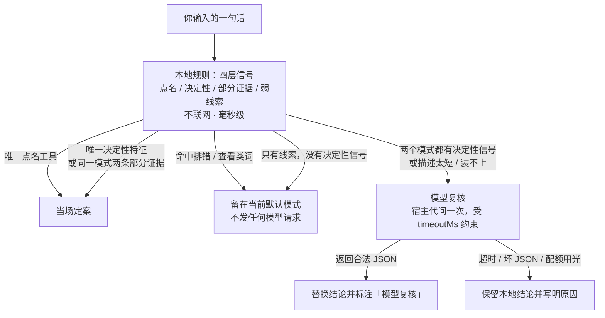

# dsh-npie-modeguide

不知道 DeepSeek Harness 的四个 Agent 预设（标准 / PTC / 极简 / 创造）该用哪个？
把任务写成一句话，这个插件帮你判断，并给出**两句可复核的理由**说明为什么。

## 它解决的问题

四个预设的描述都写得很抽象，用户常常搞不清自己该选哪个。常见的误解有三个：

- 以为「任务简单」就该用极简模式。**不对** —— 极简模式的用途是做纯净基线对照，
  不是省事。
- 以为「批量处理数据」需要换模式。**通常不必** —— 内置默认 PTC 本来就带 execute
  代码执行器；你在「设置 → Agent 预设」把默认改成别的也不要紧，插件会跟着改
  （见「新任务默认模式」一节）。
- 以为「创造模式功能最多所以最好用」。**不准确** —— 它没有 Office 工具。

## 判断原则

插件不判断「任务是什么类型」，而是判断**「任务需要哪个模式独有的工具」**。
因为四个预设只在少数工具上有差异，而这些差异才是换模式唯一正当的理由。

实测出的差异（按当前版本预设解析；能力表共有 13 行差异，下表是影响选择的 8 行节选）：

| 能力 | 极简 | 标准 | PTC | 创造 |
|---|---|---|---|---|
| 文件读写 | ✗ | ✓ | ✓ | ✓ |
| 联网检索 | ✗ | ✓ | ✓ | ✓ |
| 子代理 | ✗ | ✓ | ✓ | ✓ |
| 工作流编排 | ✗ | ✓ | **✗** | ✓ |
| execute 代码执行 | ✗ | ✗ | **✓** | ✗ |
| Office 文档 | ✗ | ✓ | ✓ | **✗** |
| 改 DSH 本体 | ✗ | ✗ | ✗ | **✓** |
| 插件管理 | ✗ | ? | ✗ | ? |

`?` = 预设里这一项带 `!!js` 平台条件，静态解析求不出值，实际取决于运行环境；
界面能力表也标 `?`。早期表格把这两格写成 ✓，等于把「视环境而定」当成了「确定有」。

由此**只有三种**情形需要换模式，其余全部留在**你设的新任务默认模式**
（下表第 4 行是「不换」；默认由宿主实时下发，不是写死的 PTC）：

| 你要做的事 | 选 | 为什么 |
|---|---|---|
| 写插件、改预设、加界面 | 创造 | 只有它有改 DSH 本体的工具 |
| workflow 大扇出编排 | 标准 | PTC 关掉了工作流工具 |
| 纯净基线 / 对照实验 | 极简 | 只有它刻意砍掉能力 |
| 其它一切（含批量处理） | 当前新任务默认 | 不换；默认若是 PTC 则带 execute 执行器 |

## 判断链路

两套判据，先用便宜的那套；只有它拿不准才动贵的。`本地` 指插件里的一段纯函数，
不联网、不碰模型；`模型复核` 指宿主代你发的一次模型请求。



本地这一层不是「猜任务类型」，只回答一个问题：**这个任务需要某个模式独有的工具吗**。
判据按「缺了它还能不能用别的模式做完」分四层，权重不同：

| 信号层 | 定案条件 | 例子 | 语义 |
|---|---|---|---|
| `pinned` 点名工具 | 单条即可 | 「写个插件」「用工作流」「跑基线」 | 你明确要它，是指令，压过其它一切信号 |
| `strong` 决定性特征 | 单条即可 | 「批处理」「批量重命名」「遍历」 | 这个词本身就意味着缺了它做不了 |
| `support` 部分证据 | 同一模式 **凑够 2 条**（弱线索算半条，向下取整） | 「统计」「重命名」「去重」「工作流」 | 是能力的一部分，不是全部 |
| `weak` 方向暗示 | 永不定案 | 「整理」「表格」「面板」 | 只作旁证 |

再加一条**组合判据**：动作词（加 / 改 / 做 / add / edit）与 DSH 内部对象（面板 /
预设 / 快捷键 / 主题 / panel / preset）出现在同一小段里，才算「要改 DSH 本身」。
单看任一边都没有意义 —— 「加一点盐」里的加、「这个面板太大」里的面板，都不该换模式。

**为什么 `support` 要凑两条**：0.1.x 一个词就定案，于是「帮我统计一下这份表格有多少行」
被判成 PTC —— 「统计」确实是能力的一部分，但标准模式的 bash 就够，压根不需要
execute。结论错了，理由却因为引用了真实能力分布而读起来像事实，这是最有欺骗性的
失败模式。现在单条线索只给方向、不定案；而「批量 + csv + 表格」这种一条部分证据加
两条弱线索的组合才算够（弱线索每条算半条：一条部分证据加一条弱线索仍然不够）。

还有一张**反向词表**：排错 / 查看 / 解释现状的说法（报错、没生效、为什么、修一下、
怎么回事 / why、not working、debug）命中即压回默认模式，而且**不再问模型**。
「我装了个插件，为什么没生效」里的「插件」是强信号，但这句话要的是排错，不是写插件。

否定词同样会作用到英文（`don't use workflow`、`don’t` 这种弯引号也算），窗口内命中
即作废。短于 4 个字的描述直接判「信息不足」。

判完只有三种去向：

1. **当场定案** —— 唯一点名、唯一 `strong`、或同一模式两条 `support`。
2. **留在当前默认模式** —— 没有决定性信号，或命中反向词。这是「已确认不用换」，
   不是拿不准，所以不会去问模型。
3. **交模型复核** —— 两个模式都有决定性信号（「这个插件要批量处理这批文件」）、
   描述太短、或该模式不在清单里。

模型复核不是让它自由发挥：宿主把当前默认模式、13 行能力差异表、五条纪律（能不换
就不换 / 别为显得聪明而建议换 / **排错类描述一律不换** / 只输出一行 JSON）一起发
过去，`maxTokens` 200、`temperature: 0`；回来严格校验 `mode` 必须在预设 id 内、
`confidence` 夹到 0.5–0.85，坏 JSON、超时、配额用光一律当「没有结论」。
示例值写成 `<one of: …>` 而不是某个具体模式，否则模型会倾向原样回抄（锚定偏置），
于是「该换也不换」而界面上看不出来。

**先后顺序**（点「给建议」那一刻）：

1. 本地规则**同步**跑完，结论、两句理由和能力表**当刻**画出来，不等任何远程调用；
2. 同一时刻后台并行做两件与判断无关的事：能力表实时校正、默认模式复查；
3. 只有第 3 类才在后台发一次模型请求，等待上限由 `timeoutMs` 派生（默认 20000 +
   2s 余量，下限 6s）；
4. 模型回来替换结论并标注「模型复核」，失败则保留本地结论并写明原因。

合并优先级是写死的：**规则已定案 > 模型结论 > 默认模式**。模型不能推翻本地已经
定案的结论 —— 「写个插件」这种你明说的事，不该被一次模型调用改错。只有单条线索时
结论同样是默认模式，但那不是「模型说的」也不是「规则说的」，理由会明说「只有线索，
不足以要求换模式」。代价是本地判错时模型也救不回来，见「已知的边界」。

## 准确率：判得对是唯一的验收线

这个插件只有一个目的：**判断必须对**。所以准确率不是一个形容词，而是一条能跑的命令：

```bash
npm run eval
# [eval] 106/106 通过（100%），用例 70 条 · main 81/81 · heldout 25/25
```

- 算例在 `test/eval/cases.json`（调规则时用的那批）与 `cases-heldout.json`
  （用完全不同的说法另写的一批，**不参与调规则**，只用来验泛化）。
- 每条用例都写清 `why`：判错时要能立刻分清是实现错还是用例本身错。
- 一半以上是「不该换」类，而且这类用例要在**两种默认**（standard / ptc）下都成立 ——
  宁可不动，不可乱动。
- `npm run check` 会跑同一份评测并卡 100%，任何一条不过就退出 1。

历史对照：0.1.11 在 14 例人工样本上是 9 对、2 例侥幸、3 例明确判错，其中
「帮我统计一下这份表格有多少行」被判成 PTC、「我装了个插件，为什么没生效」被判成
创造、「write a plugin that adds a sidebar panel」被留在默认（英文规则近乎为零）。
三条现在都是回归用例。

边界也要写清：这是一份**自建**的用例集，覆盖的是常见表达，不是你所有可能的说法。
它证明的是「这些说法判对了」，不是「所有说法都判对」。真正的兜底是界面上那两句
可展开核对的理由 —— 判错时你能看见它错在哪一行。

## 模型兜底的配额

连点「给建议」不再等于连打模型。下面几条都在宿主半区执行（客户端只负责把结论
说给用户听）：

| 限制 | 值 | 行为 |
|---|---|---|
| 突发容量 | 5 次 | 前 5 次不同输入的模型复核直接放行 |
| 补充速度 | 每 20 秒 1 次 | 用光后按此速率恢复（约 3 次/分钟持续） |
| 同句复用 | 5 分钟 | 输入与能力表都没变时直接返回上次结论（`cached: true`），**不扣配额** |
| 空输入 | — | 回 400 `invalid-input`，不扣配额：客户端的 bug 不该花你的额度 |
| 模型不可用 | — | 一次请求都没发出去（未配模型 / llm 服务缺席）时退回配额，不误报「问得太频繁」 |

配额用光时 `/judge` 回 `429` + `retryAfterMs`（响应头另带 `retry-after`），界面
据此说「约 12 秒后可再问，这次先按本地规则给建议」，而不是笼统说「模型没回应」。
秒数只从宿主下发值来 —— 客户端不存第二份配额数字，免得改了常量界面还报旧数。

配额是宿主常量 `JUDGE_LIMITS`，不在 `cordis.patch.yml` 里，改不了。要做成可配置
得先加配置 schema，属于另一件事。

## 结论里的两句理由

每次出结论都会有**两句**说明，中文界面实例如「给我写个插件」：

> 命中「写个插件、插件」，是你点名要用的工具，属于明确指令，说明这个任务取决于
> 模式之间的能力差异。依据当前版本内核预设解析出的 13 项差异，「改 DSH 本体」在
> 各模式里的分布是：只有「创造模式」具备；这就是选「创造模式」的事实依据，可展开
> 下面的差异表逐项核对。

第一句说**任务侧**：命中了什么词、是「点名指令」还是「任务特征」；只有线索时会明说
「不足以要求换模式」，一个信号都没有时明说「没有任何独有工具需求」，命中排错词时
明说「这是在排查或询问现状」。
第二句说**事实侧**：关键能力在各模式里的真实分布、差异项数、依据来源，并指向
可展开的差异表。连「该模式独占还是与别的模式共有」都是逐项读能力表算出来的，
不是写死的中文句子 —— 内核升级后写死的句子会继续用旧口径骗人。

四种结论来源口径不同：规则判断讲命中信号；模型复核会**明说来自模型、不是本地
规则**；排错类会明说「不涉及换模式」；默认结论会明说「没有任何一项差异是这个任务
必需的」，并指出留在当前默认、其它模式多出来的能力这个任务也用不上。
任何一条都不会把单条线索包装成「必须用」。实时能力表校正成功后，理由
也会按新表重算，不会出现「表里是 ✓、理由还说着关掉了」。

「绝对准确」不能承诺，边界写在这里：准确率有一条可跑的验收线（见上节），但用例集
是自建的；能力表是构建期基线（后台实时校正成功才换），内核升级后没刷新基线时事实
依据可能落后一个版本；规则识别的是明确说法，反讽、双重否定这类语义仍要靠第 3 层
或直接看官方模式下拉。

**能力表不依赖 Remote。** `ctx.remote.agentPresets` 是一个**独立的 cordis service**，
不是 `remote` 的附属属性：fiber 的 `inject` 必须单独列 `'remote.agentPresets'`
（官方 `dsh-client-ui-agent-preset` 就是这么写的）。少这一项时属性代理直接抛
`cannot get property "remote.agentPresets" without inject`，`?.` 拦不住抛 ——
0.1.3 的「预设暂时读不到」与 0.1.5 的「切换失败」其实是同一个根因。
注意 `module.exports.inject`（service 名）与 `dsh.client.inject`（预加载包名）是两层，
改错层毫无效果。即便声明齐了，unary 调用还要过 gateway carrier；离线时折进
`RemoteResult` 的 error 分支（宿主规范明写「不抛异常」），四次 `read()` 仍可能全
拿不到内容。所以能力表用构建期基线当场画，后台实时校正四个都读到才替换，
失败完全静默。

**能力表与判断主路径都不调 `agentPresets.list()`**：它会走 `diagnostic()` →
`await loader.await()` 死等，只要有一个插件行在等不来的服务就永不返回。唯一的例外是
「`/config` 没读到新任务默认」时的兜底（见下节），那一次带 1.2s 独立硬超时、纯后台，
失败就当作读不到。

客户端打开浮层时读一次宿主配置，**每次判断与需要模型兜底前再现读一次**（避免用到
打开浮层时 fire-and-forget 的旧值）：把 `llmFallback` 设成 `false` 后连模型请求都不发，
`timeoutMs` 同时决定客户端愿意等多久。

## 新任务默认模式：跟随宿主，实时响应

「设置 → Agent 预设」里的「新任务默认」是用户的选择，不是常量。宿主
`AgentPresetRegistry.defaultId` 的口径是
`config.selectedDefault.get() ?? config.default`；插件只**读**，不重写一遍判定。

宿主半区现读有两条来源：`reflect.get('agentPresets', false).defaultId`（运行时最实时），
取不到时读 `DSH_PROFILE_DIR/cordis.patch.yml` 里 `agent-preset-registry` 行的
`selectedDefault ?? default`（宿主持久化的同一份数据）。两者都失败才返回 `null`。

宿主半区每次 `/config` / `/judge` 都现读，经 `/config` 下发 `defaultMode`；浏览器半区
在浮层打开、窗口回焦、从后台切回、每 4 秒定时复查以及每次点「给建议」时重新对齐
（设置页与浮层同窗口，改完默认不会触发 `focus`，所以定时复查不可省）。值一变就：
① 用新默认重算「不用换」类结论；② 按新默认重算两句理由；③ 更新界面上的
「当前新任务默认：X」。

结论正好等于当前默认时，主按钮改成「保持当前默认」，点了给「无需切换」的可见反馈，
**不再调 `select()`** —— 否则你选了标准模式，却被插件按硬编码的 PTC 切走。读不到宿主
默认时界面标「未读到默认，按内置 PTC」，绝不把 PTC 冒充成你的选择；此时才动用官方
`agentPresets.list()` 的 `isDefault` 做后台兜底。

## 一键应用的限制

`agentPresets.select` 对**已经开始的任务**会拒绝（`agent-preset/locked`）。
所以：

- **新任务**（空白会话）：结论不同于当前默认时显示「切到这个模式」，点了立刻生效；
  结论就是当前默认时显示「保持当前默认」，点了不发起切换（见上节）。
- **进行中的任务**：只给建议，不显示应用按钮，并说明模式在创建时就定下了。

**Service 声明**：`module.exports.inject` 为 `['slots', 'remote', 'remote.agentPresets']`；
`presetsApi()` 是取 Remote 的唯一入口，属性代理抛错时退回
`ctx.reflect.get('remote.agentPresets', false)` 软取。两处调用共用，不许各写一份。

点下去之后无论成功失败，**按钮自己会变字**（切换中 → 已切换 / 重试切换），原因同时
写在按钮的 `title` 与结论区；`select` 有 2.5s 硬超时。宿主不支持切换时会明说，并指出
输入框工具栏里当前显示模式名的地方可以手动切换 —— 不写死「标准模式」，因为当前
模式未必是它。不会出现「点了完全没反应」。会话身份同时认 slot 的 `sessionId` 与
官方 `SessionSnapshot.id`。

## 能力对照表：基线 + 实时校正

`src/preset-baseline.json` 是构建时从当前安装的 `app.asar` 里
`dsh-web-app/presets/*.patch.yml` 四份真实预设解析出的能力矩阵（4 列、13 行差异），
由 `build.mjs` 内联进 `client.js`。点击当场就能画，不依赖任何 IPC。

内核升级后跑 `npm run refresh:baseline && npm run build` 即可重生数据；运行时若
`agentPresets.read()` 四个都成功，会自动换成实时版本（四个都成功才换，缺一列宁可
保留完整基线）。自定义预设不纳入对照表 —— 这是为了绕开会死等的 `list()`。

代价写清楚：Remote 不可用、且内核升级后没刷新基线时，这张表可能落后一个版本；
结论与一键应用不受影响，但**两句理由里的事实依据也跟着这张表**，所以升级后要跑
`refresh:baseline`。实时校正成功后，能力与理由会**一起按新表重算**：理由里的
差异项数、每项能力在四个模式中的分布都现读当前表，不保留旧基线的残留。

另一个边界：判断时认可的四个模式 id 来自基线列，不是当前 profile 的实时清单。
能力表与主判断路径不调会死等的 `list()`（只有默认模式兜底那一次例外，带硬超时）；
若你在 profile 里删掉了某个内置预设，插件仍可能推荐它，此时 `select()` 会失败，按钮会
明说原因。

## 有没有更简单的方法

有。四个预设只在少数工具上有差别，**真正需要换模式的情况只有三种**。多数时候不需要
「判断」，记住一句口诀即可：

> **默认别动；写插件才换创造；编排工作流换标准；极简只做对照实验。**

这句口诀也直接显示在插件浮层里。自动判断的价值主要是降低新手的心理门槛，不在于
正确率 —— 因为新任务默认（通常是 PTC，也可能被你改成别的）本来就覆盖绝大多数任务。

典型例子：**「我想写一首诗」→ 别动，留在你当前的新任务默认模式。** 若你按设置页把默认
选成标准模式，结论就是「标准模式」，不是 PTC；写诗是纯文本生成，四个预设
有差别的那 13 项能力（文件读写、联网、子代理、工作流、execute、Office、改 DSH
本体、插件管理……）没有一项为它所需，其它模式多出来的能力这个任务也用不上。
这个结论现在由本地规则当场给出，不再等模型复核。

## GitHub 上有没有同类项目

有。检索与复核结论（2026-11-15）：

| 项目 | 做什么 | 边界 |
|---|---|---|
| StephenXiong001/dsh-task-mode-switch | 工具栏切模式，AUTO 按草稿关键词选四模式 | 1 星、新建库；四模式写死在代码里；engines 写死内核版本 |
| framefutura/dsh-mode-seat | 常驻模式选择条，可设新任务默认 | 无 AUTO，只管「选」不管「该选哪个」 |
| LeemanCheung/dsh-agent-preset-recommender | 扫历史活动推荐预设 | 按过往行为，不按当前任务文本 |
| yjh051108/dsh-routing-suite | 路由思维模式 spec/react/mixed | 不是四个 Agent 预设，需注入器 |

官方内核没有这个能力：`modeSelectionEnabled` 是废弃字段，文档明确「不读也不写它」。
本插件不算重复造轮子 —— 它不硬编码能力差异，四个模式的真实组成从当前内核的
预设 YAML 解析（基线 + 可选实时校正），给出可解释的理由，且不写死内核版本。

## 安装（桌面端）

`desktop` profile 由 Electron 应用自己管理，`dsh plugin --profile desktop add ...`
会被直接拒绝（"managed exclusively by the Electron application"）。必须改三个地方：

1. `~/.dsh/profiles/desktop/package.json` 的 `dependencies` 加
   `"dsh-npie-modeguide": "link:/Users/habhy/Documents/NPIE-program/dsh_plugins_desktop/dsh-npie-modeguide"`。
2. 同一个文件的 `dsh.profile.bundles` 加 `"dsh-npie-modeguide"`。
   **只加 dependencies 不加 bundles 等于没装**：patch 不会进组合树。
3. 在 `~/.dsh/profiles/desktop/` 跑 `pnpm install`，生成 node_modules 软链。

装完必须 `Cmd+Q` 退出应用再重开。桌面端正式版没有「重新加载页面」，`Cmd+R` /
`Cmd+Shift+R` 都不会让宿主半区的路由生效；`link:` 模式下改客户端半区也要重开
App 才会重新执行 factory。

## 配置

| 字段 | 默认 | 说明 |
|---|---|---|
| `llmFallback` | `true` | 本地拿不准时是否调模型兜底 |
| `provider` | 空 | 留空 = 跟随「设置 → 模型」的默认模型 |
| `model` | 空 | 同上 |
| `timeoutMs` | `20000` | 宿主单次判定上限（夹到 120000）；客户端等待 = 它 + 2s 余量，下限 6s |

配置写在插件自己的 `cordis.patch.yml` 里（id `npie-modeguide`）。浏览器半区的
`apply(ctx, config)` 拿不到 config，所以由宿主的 `/api/npie-modeguide/config`
每次现读，客户端据此决定是否发起模型兜底请求、以及愿意等它多久。
**客户端必须比宿主晚放弃**：早期把客户端写死 6s、宿主却允许 20s，慢模型下宿主
还在算，客户端早已 abort，模型兜底永远拿不到结论。

另外 `/config` 还下发 `defaultMode`（用户的新任务默认）。它**不是**插件的配置项，不写进
`cordis.patch.yml`，而是从宿主 `agentPresets.defaultId` 现读，见「新任务默认模式」一节。

## 开发

```sh
node build.mjs        # 把 src/*.js + adapter.js + locale 词典内联进 client.js
node --test test/*.test.mjs
node scripts/eval.mjs # 准确率评测（npm run eval）
node build.mjs && node --test test/*.test.mjs && node scripts/eval.mjs   # npm run check
```

`client.js` 是构建产物，不要手改。改逻辑请改 `src/presets.js`（白名单）、
`src/capabilities.js`（解析）、`src/recommender.js`（规则与提示词）、`adapter.js`（界面）、
`locale/*.json`（文案），然后重新构建。

**改规则必须先看 `npm run eval`。** 规则是本插件唯一会影响「判得对」的东西，
而它没有类型系统可依赖：加一个词的代价是把另一类句子带偏。所以流程是
先加用例（含 `why`），再改规则，最后让两份用例集都回 100%。

提示词与 LLM 输出解析只有 `src/recommender.js` 一份：宿主 `index.js` 直接 import
它，浏览器半区由 build 内联它。这样测试测的就是实际运行的那份。

测试里有一条断言会核对 `client.js` 头部的 `source-sha1`（哈希覆盖三份源码、两份
词典与一份能力基线）：不重建就跑测试会直接失败，防止「断言在给上一版代码发合格证」。另有一条
渲染级判据会用轻量 React mock 真跑产物、**真的点一下**「切到这个模式」：核对
`agentPresets.select(sessionId, mode)` 被真调用，成功 / 宿主拒绝 / 超时 / Remote 缺席
四种结果都有可见反馈，并配一条「把 onClick 改成空函数就得红」的反向对照。只验
「按钮在」会放过「按钮点了是死的」。另有一条渲染级判据模拟 cordis 属性代理真抛
`without inject`，断言仍真调 `select` 且不把英文异常显示给用户；静态守卫要求所有
`remote.*` 访问都在 `inject` 里声明，并配「删掉声明就翻红」的反向对照。
另有判据在产物里真跑 `modelTimeoutMs()`，断言客户端等待一定长于宿主 `timeoutMs`
（把余量改成负数就得红），以及用畸形能力矩阵验证 `/judge` 不会带着未捕获异常退出。
「两句理由」这组判据会改坏能力表里的某一行，断言理由里的分布描述必须跟着变；
渲染级断言理由真的画在结论区（退回旧短 `reason` 就翻红）；端到端断言写一首诗时
一次模型请求都不发、而信号冲突时真的发 —— 两条互为反向对照，防止「0 次 POST」
变成恒真式。

## 设计边界

- **不注册模型可见的工具。** 选模式是用户自己的决定，不该被模型看见或改动。
- **不改 DSH 源码。** 全部通过 profile 挂载，升级不丢。
- **不写死内核版本。** `engines.dsh` 用宽松范围，无 `@deepseek-ai/dsh-*` peer。
- **鉴权不自己写一套。** 两条路由的受理判定复用宿主 `connection.requestRejection()`：
  Host/Origin 栅栏（防 DNS rebinding）+ 用本机签名密钥解签的 `dsh-auth-*` cookie。
  只有该 service 缺席时才退回本地轻判据（跨站拒绝、只认 `dsh-auth-*`、非 loopback 来源拒绝）。

已知的边界，诚实列出（尚未改动）：

- **只认四个内置预设。** 白名单在 `src/presets.js` 只有一份（宿主 import、客户端内联），
  但能力表也只有这四列。你自己新增一个预设时，插件读不到它作为默认（界面会标
  「未读到默认，按内置 PTC」），规则也不会推荐它 —— 因为没有任何能力数据可依据。
  要做成「任意预设」，得先从 roster 读回该预设的内容、解析出第五列，再让规则知道
  它在哪些能力上独占；那是另一块工作，半做等于给出没有依据的建议。
- **规则只处理明确说法，不处理语义。** 「不要写插件」「不用工作流」「don't use
  workflow」会在命中前先判否定；「说是插件、其实是别的意思」这类反讽仍会命中。
  本地规则终究是关键词分层，不是语义理解 —— 这也是为什么保留第 3 层模型复核。
- **能力表有版本边界，理由同表。** 见「能力对照表」一节：理由里的事实依据就是
  这张表，不会比表更新，也不会比表更旧。
- **准确率是自建用例集上的 100%，不是所有可能说法的 100%。** 见「准确率」一节。
- **配额是常量，不能微调。** 容量与补充速度写在宿主 `JUDGE_LIMITS` 里，不走
  `cordis.patch.yml`；同句复用的 key 是「文本 + 能力表 + 默认模式 + 提示词版本」，
  加个「请」就算新输入。

## 变更记录

- **0.2.0**（2026-11-16）：**判断准确率重做，并第一次有数字**。① 信号重新分四层：
  点名工具 / 决定性特征单条定案，**部分证据要同一模式 ≥2 条**，弱线索永不定案。
  修掉「帮我统计一下这份表格有多少行 → PTC」这类误判（单条「统计」不足以要求
  execute，标准模式的 bash 就够）。② 新增反向词表：报错 / 没生效 / 为什么 / 修一下 /
  why / not working 等排错与询问类描述命中即留在默认，且**不发模型请求**；修掉
  「我装了个插件，为什么没生效 → 创造」。③ 新增组合判据：动作词 + DSH 内部对象
  才算换模式（「加一个开关」算，「这个面板太大」不算）。④ 英文规则补齐：每个模式都有
  英文点名说法，ASCII 词按整词匹配（复数算同一个词），英文否定与弯引号也生效；
  修掉「write a plugin… 被留在默认」。⑤ 新增 `npm run eval` 与两份用例集
  （70 条 / 106 次断言，含 18 条不参与调规则的留出集），`npm run check` 卡 100%。
  ⑥ 修掉缓存 key 不含默认模式与提示词版本的问题（改默认后同句不再复用旧结论）。
  ⑦ 提示词去锚定（示例值改为占位）+ `temperature: 0`；能力名加「数据不是指令」围栏。
  ⑧ 白名单合成一份 `src/presets.js`（宿主 import、客户端内联）；profile 读盘加 mtime
  缓存；理由里的模式数量与空格改为按数据生成；删掉四处未使用文案与两个未读状态字段；
  打开浮层自动聚焦输入框；真 HTTP 端到端判据进仓库（`test/e2e-http.test.mjs`）。
- **0.1.11**（2026-11-16）：**模型兜底有了配额，连点不再连打模型**。① 宿主加令牌桶
  （突发 5 次、每 20 秒补 1 次）与 5 分钟结论缓存：同一句描述 + 同一张能力表直接
  复用上次结论（`cached: true`），不扣配额也不打模型。② 超限回 `429` + `retryAfterMs`
  与 `retry-after` 头；空输入回 `400 invalid-input` 且不扣配额。③ 界面区分「问得太
  频繁（约 N 秒后可再问）」与「模型没回应」，秒数只从宿主下发值来。④ README 补判断
  链路流程图、三层权重表、先后顺序与合并优先级，并新增「模型兜底的配额」一节。
  ⑤ 判据：令牌桶（含半周期与补满封顶）、缓存（TTL 与 LRU）、端到端 429 且模型调用
  次数不增、真渲染配额文案。
- **0.1.10**（2026-11-16）：**端点鉴权改回宿主自己的判定**。① 删掉 `trustedCaller`
  （「cookie 长度 ≥ 16 就放行」本机任何进程都能伪造），两条路由改为复用宿主
  `connection.requestRejection()`：Host/Origin 栅栏 + 签名 cookie 解签 + 有效期校验。
  ② 宿主异常按未认证（401）处理，不许降级成放行。③ service 缺席时退回本地轻判据：
  拒绝 `sec-fetch-site: cross-site`、只认宿主签发的 `dsh-auth-*` cookie 名、非 loopback
  来源拒绝。④ 被拒的 POST 在读 body 之前就收口，伪造请求无法触发模型调用。
  ⑤ 判据：四条 service 分支 + 六条降级分支 + 端到端 401，并与旧判据做反向对照。
- **0.1.9**（2026-11-15）：**新任务默认模式跟随宿主，实时响应**。① 宿主半区每次
  `/config` / `/judge` 现读 `agentPresets.defaultId`（`selectedDefault.get() ?? default`）
  并下发；service 取不到时读 `DSH_PROFILE_DIR/cordis.patch.yml` 里持久化的同一份值；
  插件不再写死 `ptc`。② 客户端在打开浮层、窗口回焦、后台切回、每 4 秒复查
  与每次判断时重新对齐；值一变就用新默认重算「不用换」类结论、两句理由与界面标注。
  ③ 结论等于当前默认时主按钮改「保持当前默认」，点了给「无需切换」反馈且**不再调
  `select()`**，不会把你从自己选的默认切走。④ 模型提示词里的默认模式也跟着变；
  读不到宿主默认时界面标「未读到默认，按内置 PTC」，此时才带 1.2s 硬超时调官方
  `agentPresets.list()` 的 `isDefault` 兜底。⑤ 判据补：提示词 / 结论 / 理由三层跟随、
  真渲染「改默认 → 结论从 PTC 变标准且不调 select」、反向对照、`/config` 真跑下发、
  中英词典与文档口径一致。
- **0.1.8**（2026-11-15）：**判断准确性 + 两句可复核的理由**。① 无独有工具信号（「我想写
  一首诗」）不再交模型兜底，当场定案默认模式并用 `noToolNeed` 标记；只有信号冲突、
  描述太短、模式装不上才问模型。② 弱线索不再套用强断言（「整理一份 PDF」曾被说成
  「要遍历 / 批量处理」），`composeVerdict` 对 `noToolNeed` 一律落默认。③ 明确否定
  「不要写插件」「不用工作流」不再误命中。④ 新增 `explainVerdict()`：每次结论给两句
  说明，能力事实（差异项数、各模式分布、独占还是共有）全部从当前能力表现算；实时
  校正成功后按新表重算，界面撤掉重复的命中词行、并在出结论后收起用法说明以控制
  高度（真 Chrome 量测浮层 321 → 331px，仅 +10px）；中英双语，模型结论会标明
  「来自模型复核」。判据 60 → 66 条，每条配反向对照。
- **0.1.7**（2026-11-15）：全量核查后的收敛，修三处实质缺陷。① **超时链断裂**：客户端
  写死 6s、宿主配置却允许 20s，慢模型下宿主还在算客户端已 abort，模型兜底永远
  拿不到结论；现在 `/config` 现读 `timeoutMs`，客户端等待 = 它 + 2s 余量（下限 6s），
  且每次需要兜底前现读配置，消除打开浮层时 fire-and-forget 的旧值竞态。
  ② **畸形请求体**：`/judge` 收到坏 `matrix` 时 `row.cells[c.id]` 抛 TypeError，
  而提示词构造在 `try` 之外，handler 会带未捕获异常退出、连接既不返回也不报错；
  新增宿主/客户端共用的 `sanitizeMatrix()`，构造移入 `try`，handler 加兜底 JSON。
  ③ 手动切换提示写死「标准模式」，改为指向「当前显示模式名」。同时清理口径矛盾：
  文件头仍写「能力表来自 agentPresets.read」（实际以构建期基线为准）、中文 README
  「四种」与后文及英文「三种」打架、差异表把 `?`（视环境）写成 `✓`、`files` 缺
  `build.mjs` / `scripts` / `test` 导致打包后 README 的开发与刷新基线指令失效。
  判据 55 → 60 条，新增超时链、畸形输入、真跑宿主 handler、文档口径、发布清单
  五组，各配反向对照。
- **0.1.6**（2026-11-15）：修掉「切换失败：cannot get property "remote.agentPresets"
  without inject」的真正根因。`ctx.remote.agentPresets` 是独立 cordis service，客户端
  fiber 的 `inject` 补上 `'remote.agentPresets'`（与官方 `dsh-client-ui-agent-preset`
  对齐）；两处 Remote 调用收敛为共用的 `presetsApi()`，属性代理抛错时退回
  `ctx.reflect.get(..., false)` 软取。删掉内核里根本不存在的
  `@deepseek-ai/dsh-client-ui-slots` 预加载项（写错包名会静默跳过）。判据 54 → 55：
  新增 inject 覆盖守卫、真机 proxy 抛错的渲染级判据、两条反向对照，以及「预加载包名
  必须在内核里真实存在」白名单校验。
- **0.1.5**（2026-11-15）：修「切到这个模式点了完全没反应」。旧实现在
  `remote.agentPresets.select` 缺席时**提前 return**，`setApplying` 根本没跑，按钮文字
  不变，只在滚动区塞一行 10.5px 小字 —— 用户看不见。现在任何路径都先进 `applying`，
  结果直接画在按钮上（切换中 / 已切换 / 重试切换），`select` 加 2.5s 硬超时，失败明说
  原因并给出手动切换入口；会话身份兼容 `session.id`；`dsh.client.inject` 补齐官方
  `dsh-client-ui-agent-preset` 同款依赖（gateway / session / settings / workspace）。
  判据 53 → 54 条，新增真点击 + 「死按钮」反向对照 + 「顺序颠倒」反向对照。
- **0.1.4**（2026-11-15）：能力表不再依赖 client→Host 的 Remote 调用。新增从当前
  `app.asar` 四份真实预设生成的 `src/preset-baseline.json`（4 列 / 13 行差异），
  由 `build.mjs` 内联并纳入 `source-sha1`；点「给建议」当场就画结论与能力表。
  `agentPresets.read()` 改为**后台静默校正**，四个全成功才替换基线，失败不产生任何
  错误提示或等待态；删掉 `presetTimeout` / `presetError*` / `busyPresets` 整套文案。
  补齐 `dsh.client.inject` 里的 carrier 包（`dsh-api-session-controller`、
  `dsh-client-connection`），让「一键应用」的 `select` 有机会走通。新增
  `npm run refresh:baseline` 供内核升级后重生数据。判据 49 → 53 条，含「基线清空后
  能力表必须消失」的反向对照。
- **0.1.3**（2026-11-15）：删掉导致「预设读取超时」常驻的 `agentPresets.list()` 调用。
  宿主 `list()` 会 `await loader.await()`，只要有一个插件行在等不来的服务就永不返回；
  能力表改为按四个内置 id 直接 `agentPresets.read()`（纯内存、不做激活诊断），每个
  独立 1.2s 超时。超时文案改为中性说明。新增「`list()` 永不返回但能力表照常出现」
  的反向对照渲染判据，测试 48 → 49 条。
- **0.1.2**（2026-11-15）：修复「判断中…」永久卡住 —— 本地结论改为同步先出，
  预设读取与模型复核移到后台并各带硬超时；宿主 LLM 流加独立截止点，handler 不再
  可能永不返回。工具栏入口改为紫色三节点图标，hover / 键盘聚焦显示「模式推荐」；
  浮层锚定按钮顶部向上展开，按实测高度重算并把 `maxHeight` 钳进上方空间；面板高度
  从约 500px 收到 325px，能力表改为按需展开，一屏只留一个主按钮。中英词典同步；
  新增「永不卡住」「锚定上方」等判据，测试 44 → 48 条。
- **0.1.1**（2026-11-15）：修正 `useInput` / `useSession` 的无参调用（它们是
  `SnapshotSelectorHook`，必须传 `(s) => s`；此前一键应用按钮永不出现）；接通
  `/api/npie-modeguide/config`，关掉 `llmFallback` 后客户端连请求都不发；提示词与
  LLM 解析统一到 `src/recommender.js` 一份；能力映射改为包名主体精确比较并补全
  终端能力的包名变体；中英文案接入宿主 locale 服务（`en.json` 不再写中文）；
  `slots.inject` 的 disposer 交给 `ctx.effect` 清理；加防竞态与口诀提示；补构建产物
  与渲染级判据，测试从 33 条增至 44 条。
- **0.1.0**：初版，输入框工具栏浮层 + 本地规则 / LLM 三级判断 + 实时能力对照表。
