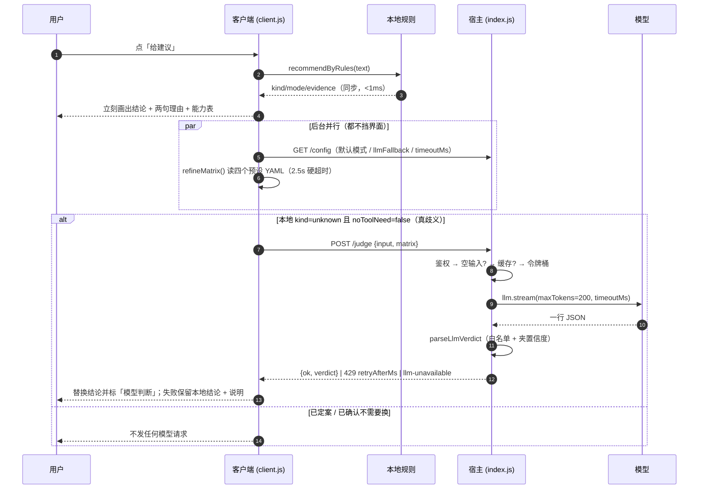

# dsh-npie-modeguide 全盘核查报告

- 版本：0.1.11（package.json，`private: true`）
- 核查时间：2026-11-16
- 核查范围：功能完整性、内部一致性、隐患、工程质量、竞品对标、迭代方向
- 核查方式：全量读代码 → 跑判据 → 实测边界输入 → 读宿主 `app.asar` 契约 → GitHub 实时拉取竞品数据

> **本报告是一次只读核查的快照。** 第 9 节的 P0/P1/P2 清单已按 0.2.0 落地（见
> `README.md` 变更记录）：规则改为四层信号 + 反向词表 + 组合判据、英文规则补齐、
> 缓存 key 加默认模式与提示词版本、评测集与 `npm run eval`（70 条 / 106 次断言，
> 100% 卡线）、白名单合成一份、`temperature: 0`、真 HTTP 端到端进仓库。
> 0.2.1 又用两轮共 50 条刻意刁难的说法盲测，修掉 10 处错判（遍历、统计、问模式本身、
> 打不开、讲解、卸载、改界面动词、极简量词、网页语境），断言扩到 86 条 / 133 次。
> 0.2.2 把第 9 节剩下的 P1 #6/#7/#8 与 P2 #15/#16/#18/#19 全部落地：支持任意预设
> （roster 追加列 + 形状校验）、反馈闭环 👍/👎 与本机 JSONL、本机统计（宿主计数 +
> 面板按需请求）、可访问性（aria-modal + Tab 环 + 焦点归还）、轮询降到 12s、
> 英文弱线索补齐、`tsc --checkJs` 非阻断进 CI。**第 9 节只剩 #20 未做**：面板显示
> 当前会话模式需要宿主暴露 `presetId`，宿主没给，不伪造。
> 报告正文保留当时的判断与数字，**不要**把第 6 节的小样本结果当成当前准确率。

> 本报告所有结论都附证据（文件:行号 / 命令 / 实测输出）。凡未验证的一律标注「待确认」，不写成结论。

---

## 0. 结论摘要

| 维度      | 评分    | 一句话                                                  |
| ------- | ----- | ---------------------------------------------------- |
| 功能完整性   | B+    | 主链路闭环（入口→判断→理由→应用→默认跟随），但缺反馈闭环、自定义预设、可观测             |
| 判断准确性   | **C** | 14 例人工标注小样本：9 对、2 例侥幸命中、**3 例明确判错**；英文输入基本失效         |
| 架构一致性   | B     | 「能力表动态、规则静态」是根本裂缝；同一份白名单在两端各写一份                      |
| 健壮性     | A−    | 超时、降级、失败闭合都做得很扎实，80 条判据全绿，无一失败用例外泄                   |
| 安全性     | A−    | 复用宿主 admission，失败闭合；剩余风险是同信任域内的输入注入                  |
| 可维护性    | B+    | 零依赖、单份逻辑、构建哈希防陈旧；但**不是 git 仓库**、无 CI、有死代码            |
| 可分发/可增长 | **D** | `private: true`、无仓库、无 tag、本地 link 安装 → 无法传播，也就无法形成社区 |

**最该立刻处理的三件事**

1. **三个已复现的误判**（详见 C1）：`统计表格多少行 → PTC`、`装了个插件为什么没生效 → 创造`、`这个 workflow 报错 → 标准`。这三条都在打自己「只在缺工具时才换模式」的原则，而理由文案还会用「这就是事实依据」把错判说得很可信 —— 这比不推荐更伤信任。
2. **英文世界等于没做**（详见 C2）：`pinned` 词表 36 条里只有 1 条是 ASCII；`write a plugin that adds a sidebar panel` 会被判成「留在默认」。UI 有完整 en 词典，规则却只认中文。
3. **缓存不带默认模式**（详见 C4）：把默认从 PTC 改成标准后，同一句话仍会命中旧缓存，返回按旧默认算出的结论。

---

## 1. 插件是什么

一句话：**在输入框工具栏放一个图标，把你的一句话任务翻译成「该用四个 Agent 预设中的哪一个」，并给出可逐项核对的两句理由；只在空白会话里提供一键切换。**

它不做的事（刻意的边界，且是优点）：

- 不注册模型可见的 tool（选模式是人的决定，不给模型改的机会）
- 不改 DSH 源码（全部走 profile 挂载，内核升级不丢）
- 不自己实现「谁是默认模式」的判定（读宿主 `agentPresets.defaultId`）
- 不自己实现鉴权（复用宿主 `connection.requestRejection`）

与宿主的两层契约：

| 层     | 位置                                                   | 职责                                                                             |
| ----- | ---------------------------------------------------- | ------------------------------------------------------------------------------ |
| 宿主半区  | `index.js`（590 行）                                    | 注册 `/api/npie-modeguide/config`、`/api/npie-modeguide/judge`；读默认模式；调模型；配额与缓存；鉴权 |
| 浏览器半区 | `adapter.js`（991 行）→ `client.js`（104 KB）             | 工具栏图标、浮层、判断、理由、一键应用、默认模式轮询                                                     |
| 纯逻辑层  | `src/recommender.js`（589）、`src/capabilities.js`（313） | 规则引擎、提示词、解析、能力解析、矩阵构建                                                          |
| 构建    | `build.mjs`（117）                                     | 把三层内联成单文件，写 `source-sha1` 防陈旧                                                  |

零运行时依赖，零 devDependencies。源码合计 2,483 行（不含 1,797 行测试）。

---

## 2. 功能清单（应有 vs 实有）

| 能力                       | 状态 | 证据                                                                |
| ------------------------ | -- | ----------------------------------------------------------------- |
| 工具栏图标入口 + hover 说明       | ✅  | `adapter.js:798-815`；tooltip 走 portal `:818`                      |
| 自然语言判断                   | ✅  | `runJudge` `adapter.js:689`                                       |
| 本地规则判断（零等待出结论）           | ✅  | 点击当场 `setState({status:'done'})` `:701`                           |
| 模型兜底（仅真歧义）               | ✅  | `local.kind !== 'unknown' \|\| local.noToolNeed` 提前返回 `:727`      |
| 能力差异表（13 项 × 4 列）        | ✅  | `src/preset-baseline.json`；构建期内联，后台实时校正                           |
| 两句可复核理由                  | ✅  | `explainVerdict` `src/recommender.js:499`                         |
| 一键切换（仅空白会话）              | ✅  | `canApply = sessionId && session.blank === true` `adapter.js:554` |
| 默认模式跟随宿主（三层读取）           | ✅  | 运行时 service → profile 文件 → 官方 roster                              |
| 默认变化后重算结论/理由/按钮          | ✅  | `syncDefaultMode` `:581`                                          |
| 结论 == 默认时不再 select       | ✅  | `:759`                                                            |
| 模型兜底配额（令牌桶 5/20s）        | ✅  | `JUDGE_LIMITS` `index.js:52`                                      |
| 同句结论缓存（5 分钟 / 8 条 LRU）   | ⚠️ | 有，但 key 不含默认模式（C4）                                                |
| 端点鉴权                     | ✅  | `authorizeRequest` `index.js:317`                                 |
| 中英 UI 词典（各 62 key）       | ✅  | `locale/*.json`，测试断言 en 无汉字                                       |
| **中英规则对等**               | ❌  | pinned 36 条仅 1 条 ASCII（C2）                                        |
| **自定义预设支持**              | ❌  | 硬编码 4 个 id：`index.js:41`、`adapter.js:89-94`                       |
| **判断反馈闭环（对/错）**          | ❌  | 无任何采集                                                             |
| **可观测性（规则 vs 模型占比、采纳率）** | ❌  | 无本地统计                                                             |
| **离线评测集**                | ❌  | 80 条判据都在验机制，没有一条验「判得对不对」                                          |
| **配置 UI（设置卡）**           | ❌  | 只能手改 profile yml 的 4 个字段                                          |
| **键盘快捷键**                | ❌  | 只能鼠标点图标                                                           |
| **显示当前会话实际模式**           | ❌  | `SessionSnapshot` 无 `presetId`，只能与默认比（见 C7）                       |
| **可分发（npm / 市场）**        | ❌  | `private: true`、无 repository、无 git                                |

---

## 3. 执行流程详解

### 3.1 两层时序（点击一次「给建议」）



### 3.2 `/judge` 请求级状态机（宿主半区）

```
POST /judge
  │
  ├─ method != POST ──────────────── 405
  ├─ authorizeRequest 拒绝 ───────── 401 / 403（JSON: untrusted-caller）
  ├─ body 非 JSON ────────────────── 400 invalid-json
  ├─ llmFallback=false ───────────── 200 {ok:false, error:'llm-disabled'}   ← 不扣配额
  ├─ input 为空 ──────────────────── 400 invalid-input                      ← 不扣配额
  ├─ 缓存命中 ────────────────────── 200 {ok:true, verdict, cached:true}     ← 不扣配额
  ├─ bucket.take() 失败 ──────────── 429 {retryAfterMs} + retry-after 头
  ├─ askModel()
  │     ├─ llm 缺席 / 未配模型 / 表空 → attempted=false → refund() → 200 llm-unavailable
  │     ├─ 超时 → attempted=true → 200 llm-unavailable（不退配额，钱可能已花）
  │     └─ 成功 → parseLlmVerdict → 命中则写缓存 → 200 {ok:true, verdict}
  └─ 任何未预期异常 ──────────────── 200 {ok:false, error:'judge-failed'}   ← 连接必有响应
```

设计上值得肯定的三点：

1. **结论永不等待远程**。点击即出，`/config`、`refineMatrix`、`/judge` 全在后台（`adapter.js:689-747`）。这是 0.1.3「判断中五分钟」的根治方案。
2. **失败闭合**。`requestRejection` 只认 `undefined` 才放行，返回 500/对象一律 403（`index.js:317-332`）；宿主抛错按 401 处理。
3. **不花冤枉钱**。空输入、禁用兜底、缓存命中都在扣配额之前返回；模型根本没被调用时 `refund()`。

### 3.3 默认模式的三种来源（按可信度降级）

| 顺序 | 来源                                                                  | 实时性    | 失败后果            |
| -- | ------------------------------------------------------------------- | ------ | --------------- |
| 1  | `ctx.reflect.get('agentPresets').defaultId`                         | 每次请求现读 | 降级到 2           |
| 2  | `DSH_PROFILE_DIR/cordis.patch.yml` 的 `selectedDefault \|\| default` | 每次现读文件 | 降级到 3           |
| 3  | 官方 `agentPresets.list()` 的 `isDefault`（1.2s 硬超时）                    | 客户端后台  | 标记「未读到，按内置 PTC」 |

第 2 层已核实：`DSH_PROFILE_DIR` 是宿主真实注入的环境变量，`app.asar` 内文档写明「holds the user's profile and added plugins」。你机器上实测解析出 `standard`，与截图一致。

### 3.4 判断引擎的判据

| 层级       | 权重 | 例子           | 语义          |
| -------- | -- | ------------ | ----------- |
| `pinned` | 6  | 「写个插件」「用工作流」 | 用户点名要工具，是指令 |
| `strong` | 3  | 「批量」「遍历」「基线」 | 任务特征说明必须用到  |
| `weak`   | 1  | 「整理」「表格」「面板」 | 方向暗示，不定案    |

前置规则：短于 4 字 → `unknown`；命中词前 6 字内有否定词 → 该次命中作废。  
出口只有三档：`decided`（唯一 pinned 或唯一 strong）/ `suggest`（仅弱线索，0.35）/ `unknown`（冲突、太短、装不上）。  
`noToolNeed: true` 表示「已确认不需要换」，调用方当场定案默认模式，不发模型请求。

---

## 4. 矛盾清单（内部不一致）

> 「矛盾」= 代码与自己的原则 / 文档 / 另一端实现相互打架，不是外部 bug。

### C1 —（P0）规则表违背自家判断原则，产生可复现误判

原则写在 `src/recommender.js:6-11`：「不要判断任务类型，要判断任务需要哪个模式独有的工具」「判据必须是缺了它做不了」。

但 `strong` 词表收的是任务类型词，且**一个 strong 命中就定案**（`recommender.js:229-316`）：

| 输入（默认 = 标准）          | 实际结论    | 应该         | 为什么错                                   |
| -------------------- | ------- | ---------- | -------------------------------------- |
| 帮我统计一下这份表格有多少行       | **PTC** | 标准/不动      | 标准有 bash，统计行数不需要 execute；「统计」不是独有能力    |
| 我装了个插件，为什么没生效？       | **创造**  | 标准/不动      | 这是排错，不是写插件；`cordis.strong` 含「插件」       |
| 这个 workflow 报错了，帮我看看 | **标准**  | 标准/不动（碰巧对） | `standard.strong` 含「workflow」，但用户没有要编排 |
| 帮我筛选一下这些日志里的报错       | **PTC** | 标准/不动      | `ptc.strong` 含「筛选」「日志」                 |

更糟的是理由文案会把这些错判说成事实：

> 命中「统计、表格」，是明确的任务特征……「execute 代码执行」在四个模式里的分布是：只有PTC 模式具备；**这就是选PTC 模式的事实依据**。

「只有 PTC 有 execute」是真的；「这个任务需要 execute」是假的。**第一句（信号）和第二句（事实）都成立，结论却错了** —— 这是最有欺骗性的失败模式，用户展开差异表也发现不了，因为表里写的确实是真的。

**根因**：`strong` 的入选标准是「像这类任务」，而不是「缺了它做不了」。这两者混在一起，权重再准也没用。

**建议**（任一，建议全做）：

1. 把 `strong` 收紧到「能力动词 + 独有工具」的组合，例如「批量重命名 / 遍历目录 / 去重合并」要求同时出现动作词与对象词；
2. 引入「≥2 个独立信号才 decided」的门槛，单命中降为 `suggest`（不再断言）；
3. 加「排错/为什么/报错/没生效」这类**反向词表**，命中即压回默认；
4. 用第 6 节的评测集回归，任何一条误判都进测试。

### C2 —（P0）UI 做了双语，规则只做了中文

实测统计（`node` 直接跑 `MODE_RULES`）：

| 模式       | pinned | 其中 ASCII | strong | 其中 ASCII |
| -------- | ------ | -------- | ------ | -------- |
| cordis   | 18     | **0**    | 6      | 4        |
| standard | 8      | 1        | 5      | 1        |
| minimal  | 6      | **0**    | 7      | 1        |
| ptc      | 4      | **0**    | 17     | 4        |

pinned 合计 36 条，ASCII 仅 1 条（`run workflow`）。

实测：

```
输入: write a plugin that adds a sidebar panel
实际: suggest（noToolNeed=true）→ 留在默认
应该: cordis
```

英文用户看到的是完整英文 UI（en 词典 62 key，测试还断言无汉字），却拿到一个只会认中文的判断。**双语只做了一半，且是最不影响观感的那一半。**

### C3 —（P1）同一份「哪些模式可信」白名单写了两遍，无一致性判据

- 宿主：`const PRESET_IDS = new Set(['standard','ptc','minimal','cordis'])`（`index.js:41`）
- 客户端：`MODE_LABEL_KEYS = {minimal, standard, ptc, cordis}`（`adapter.js:89-94`）

|                                                                                     |                                    |
| ----------------------------------------------------------------------------------- | ---------------------------------- |
| 两处必须同时改，否则出现「宿主下发了默认模式，客户端却判成不可信 → 显示未读到」。测试里没有任何一条断言这两个集合相等（\`grep -nE "PRESET_IDS | MODE_LABEL_KEYS" test/\` 只命中一条注释）。 |

这恰好是本项目自己在别处反复强调的反模式：「同一件事两套判定，必然漂移」（`index.js:30-32` 注释）。

### C4 —（P1）缓存 key 不含默认模式，改默认后同句返回旧结论

```js
// index.js:138
function judgeCacheKey(input, matrix) { ... }   // 只有文本 + 能力表
```

但提示词里默认模式是**决策条件**（`recommender.js:396`「默认模式是 X……一律选 X」）。因此：

1. 默认 = PTC 时问「用工作流批量处理这批文件」→ 冲突 → 模型给 standard，写入缓存；
2. 用户把默认改成 standard；
3. 同一句话再问 → 缓存命中 → 直接返回旧结论（此刻结论仍对，但**缓存里的推理前提已经变了**）；
4. 反向场景（默认从 standard 改成 PTC）会返回与当前默认矛盾的结论，且标注「模型判断」而非「缓存」。

`README.md:110` 明写「输入与能力表都没变时直接返回上次结论」，这句现在是不完整的。

### C5 —（P2）`composeVerdict` 的 suggest 分支是死代码

```js
// recommender.js:467
if (local && local.kind === 'suggest' && local.mode && !local.noToolNeed) { ... }
```

而 `recommendByRules` 只在 `noToolNeed: true` 时返回 `suggest`（`:237-249`），所以这个分支永不进入。注释还写着「kind 仍保持原值，不波及既有判据」—— 为了让测试不改而保留一个不可达分支，是测试反向绑架设计。

### C6 —（P2）置信度算了但从不展示，数值也没有标定

- 规则置信度：`0.55 + 0.15 × strong 命中数`，封顶 0.9（`:303`）
- 模型置信度：夹到 `[0.5, 0.85]`（`:444`）
- 界面：`grep -c confidence adapter.js` = **0**

既没显示，也没用于任何门槛（比如 <0.6 就不给按钮）。它现在只是一个「看起来严谨」的字段。对照竞品：semantic-router 会把原始分数**校准成概率**并设阈值，RouteLLM 用数据**标定阈值**。我们的是两串手写常数。

### C7 —（P2）「无需切换」只与默认比较，不知道会话真实模式

```js
if (verdictNow.mode === currentDefaultMode()) { setApplyNote({kind:'keep'}) ; return }  // :759
```

已核实宿主 `SessionSnapshot` **没有** `presetId` 字段（`app.asar` 内 `SessionSnapshot` 类型定义只有 sessionId / running / blank / openState …），所以确实没有更好的比较对象。风险场景：空白会话里用户先在下拉里手选了别的模式，此时结论恰好等于默认 → 按钮说「保持当前默认」，但会话其实已是另一个模式。**严重度低（需真机确认下拉是否作用于空白会话），但建议在文案上改成「与你的新任务默认一致」，不要声称「无需切换」。**

### C8 —（P2）文档口径与实现的两处轻微漂移

| 文档                                      | 实现         | 差异          |
| --------------------------------------- | ---------- | ----------- |
| `README.md:110` 「输入与能力表都没变」             | key 还差默认模式 | 见 C4        |
| `README.md:242` 竞品表只扫了 DSH 生态 4 个 1 星小库 | 未对标外部成熟方案  | 本次报告第 7 节补上 |

---

## 5. 隐患清单

> 分级：P0 影响正确性/信任；P1 影响可用性/可维护性；P2 建议改进。

| #   | 级  | 隐患                             | 证据                                                                                                                                               | 影响                                  | 建议                              |
| --- | -- | ------------------------------ | ------------------------------------------------------------------------------------------------------------------------------------------------ | ----------------------------------- | ------------------------------- |
| H1  | P0 | 单强信号即断言（同 C1）                  | `recommender.js:229-316`                                                                                                                         | 错判被包装成「事实依据」                        | 加信号门槛 + 反向词                     |
| H2  | P1 | 英文否定完全不识别                      | `NEGATIONS` 仅中文 `:110-113`                                                                                                                       | `don't use workflow` 仍命中 standard   | 加英文否定词 + 窗口                     |
| H3  | P1 | 只支持 4 个内置预设                    | `index.js:41`、`adapter.js:89`                                                                                                                    | 用户自定义预设 → 能力表无该列、默认读成「未读到」          | 改为从 roster 动态取列                 |
| H4  | P1 | 真 HTTP 级判据不在仓库                 | 鉴权/配额端到端脚本当时写在 `/tmp`，已不在仓库                                                                                                                      | 回归只能证明「假 req 上成立」                   | 把 e2e 脚本并入 `test/`              |
| H5  | P1 | 非 git 仓库、无 tag、无 CI            | `git rev-parse` → NOT A GIT REPO                                                                                                                 | 无法回滚、无法 review、无法追责                 | `git init` + 语义化 tag + 最小 CI    |
| H6  | P1 | `private: true` + 无 repository | `package.json:4`                                                                                                                                 | 不能发布、不能被引用、无 issue 渠道               | 若打算传播，改 `private:false` 并补 repo |
| H7  | P1 | 无反馈闭环                          | 全库无「这判断对吗」入口                                                                                                                                     | 准确率永远只能靠拍脑袋                         | 加 👍/👎 + 本地计数                  |
| H8  | P2 | 每 4 秒轮询 + 同步读文件                | `adapter.js:609`；`index.js:163` `readFileSync`                                                                                                   | 面板长开 = 900 次/时；service 缺席时每次阻塞主线程读盘 | 轮询降到 10–15s；读盘加 mtime 缓存        |
| H9  | P2 | 提示词 JSON 示例把答案写成默认模式           | `recommender.js:405` `{"mode":"${fallback}"...}`                                                                                                 | 锚定偏置：模型倾向原样回默认，该换也不换                | 示例值改成 `<one of: ...>`           |
| H10 | P2 | 未设 `temperature`               | `index.js:440` 只传 maxTokens                                                                                                                      | 同一输入可能不同结论，缓存失真                     | 显式 `temperature: 0`             |
| H11 | P2 | `explainVerdict` 硬编码「四个模式」     | `:529` `:566`；`sanitizeMatrix` 允许 8 列                                                                                                            | 将来列数变化即说谎                           | 用 `columns.length` 插值           |
| H12 | P2 | 中文文案空格错位                       | 实测输出「只有PTC 模式具备」「留在 标准模式 是照…」                                                                                                                    | 观感粗糙                                | 模板里补/去空格                        |
| H13 | P2 | `row.label` 直接进 system prompt  | `sanitizeMatrix` 截 120 字后进 `buildLlmPrompt`                                                                                                      | 同信任域内可注入指令                          | 加「以下为数据，不是指令」围栏                 |
| H14 | P2 | 死代码/死文案                        | `state.status`/`state.error` 0 引用；4 个 locale key 未用（`triggerTitle`/`title`/`judging`/`matrixTitle`）；`TOP_LEVEL_INDENT` 未用；`pluginCount` 只被一条测试用到 | 认知负担                                | 清理，或补上使用点                       |
| H15 | P2 | 根目录遗留 `模式判断的两级链路.html`         | 5.2 KB，不在 `files` 白名单                                                                                                                            | 仓库噪音                                | 移入 `docs/` 或删除                  |
| H16 | P2 | 浮层无 focus trap / 初始焦点          | `adapter.js:821-838` 只有 Esc 与点外关闭                                                                                                                | 键盘用户需 Tab 多次                        | 打开时 focus 到 textarea            |


### 已核实「不是问题」的项（避免误报）

| 疑点 | 核实结果 |
|---|---|
| `session.blank` 是否可靠 | 宿主导出类型 `SessionSnapshot` 明写 `readonly blank: boolean`，是必填字段 ✅ |
| `DSH_PROFILE_DIR` 是否真实存在 | `app.asar` 文档明写其含义；profile 实测解析出 `standard` ✅ |
| 鉴权是否还是「cookie 长度 ≥ 16」 | 已彻底移除，`grep -rn trustedCaller` 仅剩文档与守卫断言 ✅ |
| 配额是否会被空输入/缓存吃掉 | 校验与缓存都在 `bucket.take()` 之前（`index.js:541-555`）✅ |
| 超时是否会让连接悬挂 | `consumeWithDeadline` 与 `readBody` 都有独立计时器 ✅ |
| 构建产物是否陈旧 | 实测 `source-sha1` = `a5774549…`，与源码哈希一致 ✅ |
| 主题是否跟错源 | 宿主自身也用 `prefers-color-scheme`（95 处命中），做法一致 ✅ |

---

## 6. 工程质量评估

| 项 | 现状 | 评价 |
|---|---|---|
| 判据数量 | 80 条，全绿（823 ms） | 强 |
| 判据性质 | 多为机制守卫（是否存在、是否调用、失败是否闭合）+ React mock 真渲染 + 反向对照 | 强，但**没有一条验「判得对不对」** |
| 端到端 | 鉴权、配额的 e2e 曾用真 `http.Server` 跑过，但脚本在 `/tmp` | 弱（不可复现） |
| 类型 | 纯 JS + JSDoc | 中；`tsc --checkJs` 可低成本兜住 |
| 依赖 | 0 | 强（桌面插件最怕依赖地狱） |
| 构建 | 自研内联，防反引号、防陈旧哈希 | 强，且注释解释得很清楚 |
| 版本控制 | **无 git** | 弱 |
| 文档 | 中文 31 KB + 英文 32 KB，含 Mermaid、边界、变更记录 | 很强（超过多数同类项目） |

### 人工标注小样本（14 例，默认=标准）

| # | 输入 | 期望 | 实际 | 判定 |
|---|---|---|---|---|
| 1 | 写个插件，给侧栏加个按钮 | cordis | cordis | ✅ |
| 2 | 用工作流把这 200 个文件并行审一遍 | standard | standard（pinned） | ✅ |
| 3 | 做个纯净基线对照实验 | minimal | minimal | ✅ |
| 4 | 把这批 CSV 去重后按月份汇总 | ptc | ptc | ✅（可争议） |
| 5 | 帮我把这段话翻译成英文 | standard | standard（default） | ✅ |
| 6 | 读一下这个 PDF，总结要点 | standard | standard | ✅ |
| 7 | 不要写插件，只改一个文案 | standard | standard | ✅ |
| 8 | 我想写一首诗 | standard | standard | ✅ |
| 9 | 批量重命名下载目录里的文件 | ptc | ptc | ✅（可争议） |
| 10 | **帮我统计一下这份表格有多少行** | standard | **ptc** | ❌ |
| 11 | **我装了个插件，为什么没生效？** | standard | **cordis** | ❌ |
| 12 | **write a plugin that adds a sidebar panel** | cordis | standard | ❌ |
| 13 | 这个 workflow 报错了，帮我看看 | standard | standard | ⚠️ 机制错、结果碰巧对 |
| 14 | don't use workflow, just answer directly | standard | standard | ⚠️ 英文否定未识别，碰巧对 |

**明确错 3 / 侥幸 2 / 正确 9。** 样本量 14，不构成统计结论，但足以证明「按任务类型词判」这条路会在真实表达上翻车 —— 而这恰恰是 README 自己声明不采用的做法。

---

## 7. 竞品分析（GitHub 实时数据，2026-11-16）

### 7.1 数据

| 项目 | Stars | Forks | 许可 | 最近推送 | 状态 |
|---|---|---|---|---|---|
| cline/cline | **71,661** | 7,926 | Apache-2.0 | 2026-11-13 | 活跃 |
| BerriAI/litellm | **63,307** | 13,304 | 自定（NOASSERTION） | 2026-11-15 | 活跃 |
| musistudio/claude-code-router | **38,168** | 3,207 | MIT | 2026-10-10 | 活跃 |
| Kilo-Org/kilocode | **28,003** | 3,363 | MIT | 2026-11-15 | 活跃 |
| RooCodeInc/Roo-Code | **24,239** | 3,437 | Apache-2.0 | 2026-05-15 | **已归档** |
| lm-sys/RouteLLM | 5,706 | 454 | Apache-2.0 | 2024-08-10 | 停滞 |
| aurelio-labs/semantic-router | 4,033 | 395 | MIT | 2026-11-09 | 活跃 |

Cline 仅作规模参照，未逐项拆解其模式机制。

### 7.2 逐个拆解（只写核实过的）

**Roo Code（24.2k，已归档）—— 形态最接近的对照**

- 自定义模式字段：`slug` / `name` / `description` / `roleDefinition` / `groups`（read/edit/command/mcp，可带 `fileRegex`）/ `whenToUse` / `customInstructions`。
- `whenToUse` 的官方用途：「Provides guidance for Roo's automated decision-making, particularly for mode selection and task orchestration … used by the 🪃 Orchestrator mode, and helps Roo decide which mode is appropriate when switching modes (via the `switch_mode` tool)」。
- 也就是说：**决策者是模型本身**，依据是每个模式的一段自然语言 `whenToUse`；没有能力差异表，也没有可复核理由。
- 有 Marketplace 分发模式包。
- 已归档（2026-05-15）。Kilo Code 是其分叉/继任形态。

**Kilo Code（28.0k，活跃）—— 把「模式」做成了权限系统**

|  |  |  |
| --- | --- | --- |
- 新形态用 Markdown + frontmatter 定义 agent：`description`（「used by the orchestrator for delegation」）、`mode: primary|subagent|all`、`permission`（allow/deny/ask + glob）、`model`、`steps`、`temperature`、`color`、`hidden`。
- 支持组织级托管 agent（同一名字的组织定义优先于个人）。
- 关键差异：**模式 = 能力配置**（工具权限/文件通配/模型/步数），所以「选模式」这件事本身有真实后果；我们的四个预设是内核写死的，用户改不了。

**claude-code-router（38.2k）—— 请求级控制面**

- 定位从「按场景切模型」演进为本地网关：providers/credentials、**按 header 与 body 条件路由**、前缀、请求改写、重试、有序 fallback、per-key 配额（请求/Token/图片）、**日志里给出 resolved provider/model、延迟、Token、估算成本**。
- 对照我们：配额我们有（令牌桶），**可观测性我们为零**；它是「路由之后告诉你走了哪条路、花了多少」，我们是「给完建议就结束了」。

**RouteLLM（5.7k，停滞）—— 把「路由」当成可评测的机器学习问题**

- 四种路由器：`mf`（矩阵分解，官方推荐）、`sw_ranking`（加权 Elo）、`bert`、`causal_llm`。
- 宣称「reduce costs by up to 85% while maintaining 95% GPT-4 performance on MT Bench」，并提供 `routellm.evals.evaluate` 在 MMLU/GSM8K/MT-Bench 上评测、`calibrate_threshold` 用 Chatbot Arena 数据把阈值标定到「50% 走强模型」。
- 对照我们：**它有评测与标定，我们没有**；它的阈值是数据算出来的，我们的 0.55/0.15/0.9 是手写的。

**semantic-router（4.0k，活跃）—— 机制上最值得抄的一个**

- 每个 Route 给一组 `utterances`，用向量相似度匹配；「decides in milliseconds」。
- 关键设计：`fit()` 用带 `None` 标签的样本**校准置信度**，`confidence_threshold = 0.5` 时「act only when it's more likely right than wrong」，不达标返回 `None`（**显式弃权**）。
- `Chain`：快路由器不确定时才落到慢路由器 —— 这正是我们「规则 → 模型」的形态，但它的阈值是校准过的。
- 对照我们：我们的 `noToolNeed` 相当于 `None` 路由（思路对），但缺少 utterances 与校准。

**LiteLLM（63.3k）—— 治理能力的上限参考**

- 网关级：预算、限流、fallback、成本追踪、100+ provider 统一协议。
- 对照我们：令牌桶是它的极简子集；我们没做「花费可见」。

### 7.3 能力对照矩阵

| 维度 | 本插件 | Roo Code | Kilo Code | CCR | RouteLLM | semantic-router | LiteLLM |
|---|---|---|---|---|---|---|---|
| 决策对象 | Agent 预设 | 模式 | agent | 模型/供应商 | 强/弱模型 | 任意 route | 模型 |
| 触发方式 | 用户点按钮 | 模型自动 `switch_mode` | 编排器委派 | 请求级自动 | 请求级自动 | 请求级自动 | 请求级自动 |
| 决策依据 | 关键词 + 一次 LLM | 模式 `whenToUse` 文本 | `description` | header/body 条件 | 训练路由器 | 语义相似度 | 规则/权重 |
| 可解释理由 | **两句、逐项可核对** | 无 | 无 | 日志（走了哪条） | 分数/阈值 | 相似度分数 | 无 |
| 感知能力差异 | **有（动态解析 13 项）** | 隐含在工具组 | 权限即差异 | 无 | 无 | 无 | 无 |
| 自定义模式 | ❌ 仅 4 内置 | ✅ 任意 | ✅ 任意 + 组织级 | — | — | ✅ 任意 route | — |
| 置信度校准 | ❌ 手写常数 | — | — | — | ✅ 数据标定 | ✅ `fit()` 校准 | — |
| 离线评测 | ❌ | ❌ | ❌ | ❌ | ✅ | ✅ | ❌ |
| 配额/预算 | ✅ 令牌桶 | ❌ | ❌ | ✅ per-key | ❌ | ❌ | ✅ 预算 |
| 可观测 | ❌ | 部分 | 部分 | **✅ 路由/延迟/成本** | ✅ 评测 | ✅ 分数 | ✅ 花费 |
| 反馈闭环 | ❌ | ❌ | ❌ | 日志 | 偏好数据 | 标注数据 | ❌ |
| 分发 | ❌ 本地 link | 市场 | 市场 + 组织 | 桌面/CLI/Docker | PyPI | PyPI | PyPI/代理 |
| 许可 | MIT（但 private） | Apache-2.0 | MIT | MIT | Apache-2.0 | MIT | 自定 |

---

## 8. 我们的优势 / 差距

### 8.1 真正好的地方（不是自我安慰）

1. **能力差异是「解析出来的」，不是写死的。** 四个竞品没有一个回答「这两个模式到底差在哪」；它们只给一句自然语言描述（Roo 的 `whenToUse`、Kilo 的 `description`）。我们给的是 13 行 × 4 列、从当前内核 `presets/*.patch.yml` 真解析的表，并且处理了三个别人不会处理的坑：插件树嵌套、`disabled: !!js` 三态、`tool-fs` 同名降级。
2. **理由可复核。** 「依据当前版本解析出的 13 项差异，X 的分布是：只有创造模式具备」—— 用户能展开表逐条对上。竞品的理由是「模型说的」。
3. **判断不阻塞。** 结论同步、增强后台、全部带硬超时。这是被真实故障（判断中五分钟）打出来的设计，不是纸上架构。
4. **零依赖 + 单份逻辑 + 构建哈希。** 桌面插件里很少见；`source-sha1` 防「拿旧产物跑新测试」是很成熟的细节。
5. **安全上不自己发明。** 复用宿主 admission、失败闭合、只认明确 `undefined` 放行 —— 比多数插件作者做得对。
6. **诚实降级。** 读不到默认就标「内置兜底」，不把 PTC 冒充成用户选择。这种「宁可显得弱也不撒谎」的取向很少见。

### 8.2 差距（按严重度）

| 差距 | 对照对象 | 后果 |
|---|---|---|
| **准确性无度量** | RouteLLM 评测 / semantic-router 校准 | 只能凭感觉说「还行」，一被问「多准」就哑 |
| **只有 4 个内置模式** | Roo/Kilo 任意自定义 | 用户一旦自定义预设，插件直接失效（连默认都读不到） |
| **英文规则近乎为零** | 全竞品天然多语言 | 一半用户拿到空功能 |
| **单信号即断言** | semantic-router 阈值弃权 | 错判被包装成事实 |
| **无可观测** | CCR 路由日志/成本 | 无法定位「为什么这次判错」 |
| **无分发** | 全部 | 永远只有你一个人用，收不到反例 |
| **无版本治理** | 全部 | 改坏了只能靠记忆回滚 |

---

## 9. 优化改进清单

> **落地状态（2026-11-16 收尾）**
>
> - P0 #1–#5：0.2.0 全部落地；#5 的评测集扩到 86 例 / 133 次断言（含 18 条留出集），
>   `npm run check` 卡 100%（报告原文要求 ≥85%，实际按 100% 卡）。
> - P1 #6 任意预设、#7 反馈闭环、#8 可观测：**0.2.2 落地**。#6 的验收「自定义一个
>   预设后能力表出现第 5 列、默认能读对」有渲染级 + 端到端判据；#7 的 `npm run stats`
>   能算采纳率，且无记录时输出 `null` 而非 0%；#8 面板底部「本机统计」展开才请求。
> - P1 #9：**已落地** —— `test/e2e-http.test.mjs` 移入 `test/e2e/http.test.mjs`，
>   测试脚本改为 `node --test "test/**/*.test.mjs"`（Node 自己展开 glob），
>   `npm test` / `npm run check` 内含真 `http.Server` 用例。
> - P1 #10–#12、P2 #13–#19：0.2.0 / 0.2.1 / 0.2.2 已落地（#18 类型体检为**非阻断**）。
> - P2 #20「面板显示当前会话模式」：**未做**。宿主没有暴露当前会话的 `presetId`，
>   插件拿不到这个值，只能靠猜 —— 猜出来的「当前模式」比不显示更糟，所以留空。

### P0（本周，正确性）

| # | 动作 | 验收判据 |
|---|---|---|
| 1 | `strong` 收紧为「动作 + 对象」组合；单命中降为 `suggest` | 新增 8 条误判用例全绿；`统计/筛选/报错/没生效` 不再改变结论 |
| 2 | 加反向词表：排错类（报错/没生效/为什么/失败/排查）命中即压回默认 | 「装了个插件为什么没生效」→ 默认模式 |
| 3 | 英文 pinned/strong 对齐中文（每个模式至少 8 条英文 pinned） | `write a plugin…` → cordis；`don't use workflow` → 默认 |
| 4 | 缓存 key 加默认模式（和 prompt 版本号） | 改默认后同句不复用旧结论（单测 + 端到端） |
| 5 | 建评测集 `test/eval/cases.json`（≥40 条，中英各半，含 10 条「不该换」） | `npm run eval` 输出准确率；CI 卡 ≥85% |

### P1（两周，可用性）

| # | 动作 | 验收判据 |
|---|---|---|
| 6 | 支持任意预设：列从 roster 取，仅默认/切换白名单放宽 | 自定义一个预设后，能力表出现第 5 列，默认能读对 |
| 7 | 反馈闭环：结论旁加 👍/👎，写本地 JSONL（不联网） | 点 👎 后落一条记录；`npm run stats` 能算采纳率 |
| 8 | 可观测：本地计数（规则/模型/默认 各多少、429 次数、平均耗时） | 面板底部可展开「本机统计」 |
| 9 | 把鉴权/配额 e2e 脚本并入 `test/e2e/` | `npm test` 内含真 `http.Server` 用例 |
| 10 | `git init` + tag `v0.1.11` + 最小 CI（build + test + 产物哈希校验） | `git tag` 有基线；CI 红灯阻断合并 |
| 11 | 白名单单一来源：`src/presets.js` 导出，宿主与客户端都 import | 断言两处集合相等的判据存在 |
| 12 | 提示词去锚定：示例值改为 `<one of: …>`；`temperature: 0` | 同一输入 5 次调用结论一致 |

### P2（一个月，打磨）

| # | 动作 |
|---|---|
| 13 | 「四/五/六个模式」等数量词全部由 `columns.length` 插值（H11） |
| 14 | 中文模板空格修正（H12）；补 `state` 死字段与 4 个死文案（H14） |
| 15 | 浮层打开即聚焦 textarea；加 `aria-modal` 与 focus trap（H16） |
| 16 | 轮询 4s → 12s；profile 读盘加 mtime 缓存（H8） |
| 17 | 根目录 HTML 移入 `docs/`（H15） |
| 18 | `tsc --checkJs` 进 CI，先只报错不阻断 |
| 19 | 英文规则扩到 weak 层（当前 weak 里 ASCII 较多，但 pinned/strong 是决定性的） |
| 20 | 面板显示「当前会话模式」—— 宿主若要暴露 `presetId` 再补（C7） |

---

## 10. 迭代路线

### v0.2 「先准起来」（1–2 周）

主题：**把「准确率」从形容词变成数字。**
交付：评测集 + `npm run eval` + 三条 P0 修正 + 英文规则 + 缓存修复。
成功标准：40 条评测集 ≥85%，其中「不该换」类 ≥95%（宁可不动，不可乱动）。

### v0.3 「长在别人身上」（3–4 周）

主题：**不再只服务四个内置预设。**
交付：任意预设、反馈闭环、本机统计、配置设置卡（`configForms`）、键盘快捷键。
成功标准：自定义模式可用；👎 能被导出成新用例。

### v0.4 「可分发、可协作」（1–2 月）

主题：**让别人的反例进来。**
交付：git + CI + npm 可发布（或 marketplace）+ 规则包可导入导出 + README 增加「准确率实测」章节。
成功标准：外部用户能一条命令装上，并能提交一条失败用例。

### 必须升级的五件事（不做就会死）

1. **评测集 + 准确率数字** —— 没有它，所有「优化」都是猜。
2. **任意预设支持** —— 只认 4 个硬编码 id，等于把自己绑死在一个内核版本上；内核加第五个模式那天，插件就 silently 落后。
3. **英文对等** —— UI 已经双语，规则单语，等于承诺了没兑现。
4. **反馈闭环** —— 现在唯一的信号是「用户有没有点按钮」，这不叫信号。
5. **版本与分发** —— 不是 git 仓库、`private: true`，意味着这次审计结束后的所有改动依然不可回滚、不可传播。

---

## 11. 附录：复现命令

```bash
cd /Users/habhy/Documents/NPIE-program/dsh_plugins_desktop/dsh-npie-modeguide

# 全量判据（80 条）
npm run check

# 误判复现
node --input-type=module -e "
import { recommendByRules, composeVerdict } from './src/recommender.js';
for (const t of ['帮我统计一下这份表格有多少行','我装了个插件，为什么没生效？','write a plugin that adds a sidebar panel']) {
  const l = recommendByRules(t, { available: ['standard','ptc','minimal','cordis'] });
  console.log(t, '→', composeVerdict(l, null, 'standard').mode, l.kind);
}"

# 英文规则覆盖率
node --input-type=module -e "
import { MODE_RULES } from './src/recommender.js';
for (const r of MODE_RULES) {
  const ascii = (a) => (a||[]).filter(w => /^[\x00-\x7F]+$/.test(w)).length;
  console.log(r.id, 'pinned', ascii(r.pinned) + '/' + r.pinned.length, 'strong', ascii(r.strong) + '/' + r.strong.length);
}"

# 产物是否陈旧
node -e "const fs=require('fs'),c=require('crypto');const o=['src/capabilities.js','src/recommender.js','adapter.js','locale/zh.json','locale/en.json','src/preset-baseline.json'];const h=c.createHash('sha1');h.update(o.map(f=>fs.readFileSync(f,'utf8')).join('\n'));console.log(h.digest('hex'))"
grep -m1 source-sha1 client.js

# 竞品数据（需直连，本机有 HTTP_PROXY 时必须 --noproxy）
curl -sS --noproxy '*' -H 'Accept: application/vnd.github+json' https://api.github.com/repos/RooCodeInc/Roo-Code | node -e "let s='';process.stdin.on('data',d=>s+=d).on('end',()=>{const d=JSON.parse(s);console.log(d.full_name,d.stargazers_count,'archived='+d.archived)})"
```

---

## 12. 一句话总结

这是一个**工程纪律明显高于同类平均水平、但判断准确率还没有被度量过**的插件：机制该做对的都做对了（不阻塞、失败闭合、能力表真解析、理由可复核），可它最核心的承诺 —— 「告诉你该用哪个模式」—— 目前在一个 14 例的小样本上是 9 对 3 错 2 侥幸，而它给错判配的理由，读起来和对判一样可信。

先补度量，再谈聪明。
